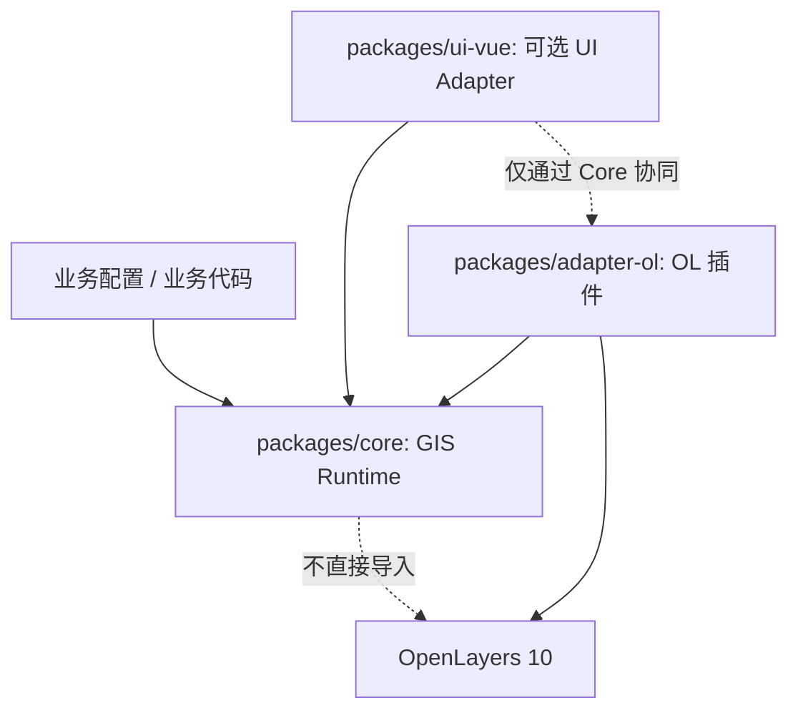
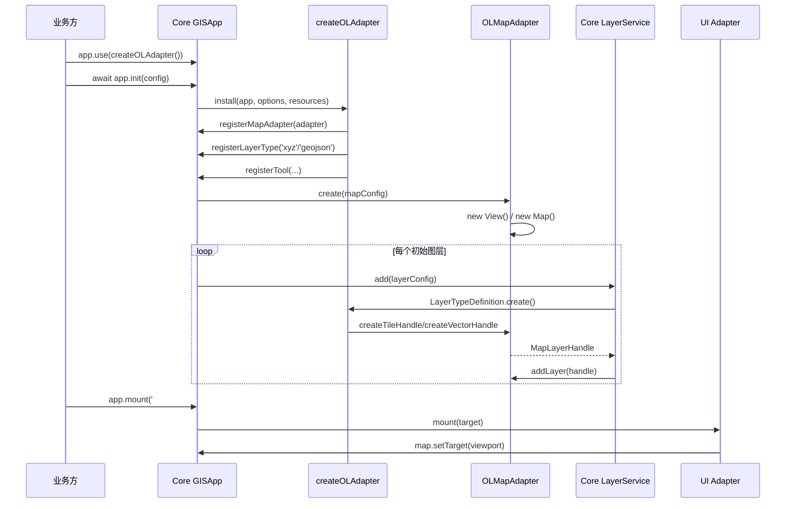
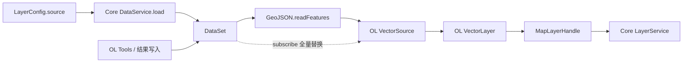
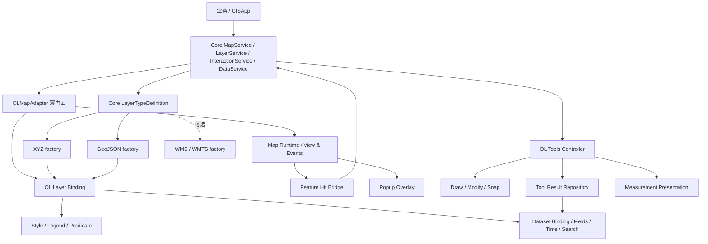
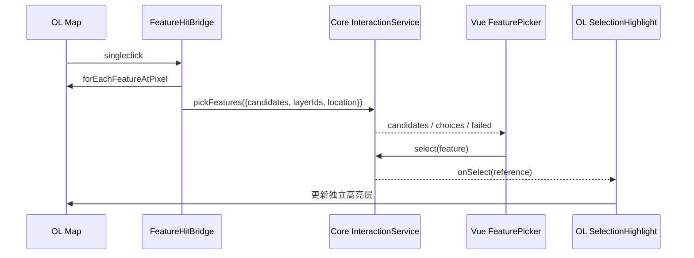
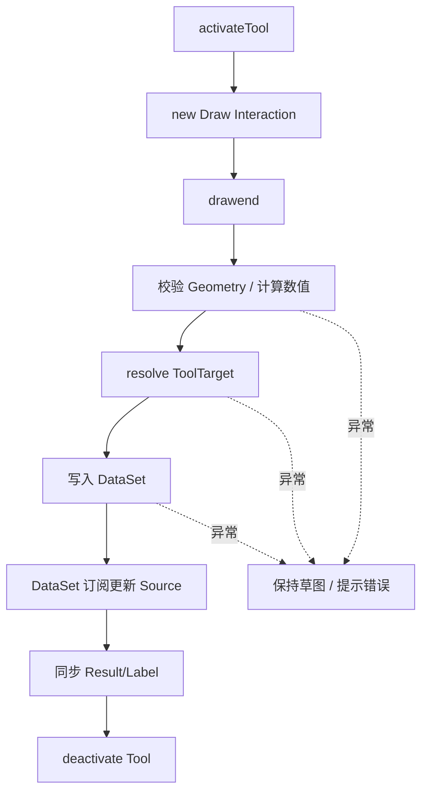

# create-gis-app / adapter-ol 代码审查与架构重构设计（V2）

> **文档性质**：基于真实仓库源码的设计评审及渐进式实施方案，不是已经实施的代码修改。  
> **评审日期**：2026-11-25  
> **仓库**：[flyFishHy/create-gis-app](https://github.com/flyFishHy/create-gis-app)  
> **基线分支**：`main`  
> **基线提交**：[`ca013cafb027e7aeac3180dfc08293cdeaa43214`](https://github.com/flyFishHy/create-gis-app/commit/ca013cafb027e7aeac3180dfc08293cdeaa43214)  
> **适用技术栈**：TypeScript、OpenLayers 10.11、pnpm Monorepo、Vue 3（独立 UI Adapter）  
> **评审方式**：GitHub 静态源码审查 + 已有测试阅读 + OpenLayers 官方 API 核对。**未在本次评审中执行仓库测试、浏览器 E2E 或性能基准。**

---

## 0. 执行摘要与决策

### 0.1 一句话结论

当前 `adapter-ol` **已经有基本正确的边界契约，但缺少适配器内部的层次与职责分配**。主要问题并非“没用设计模式”，而是 `OLMapAdapter`、`createVectorHandle()`、`createHandle()`、`installOLTools()` 几处集中承载了太多不同方向的变化，造成扩展需要持续修改存量复杂函数。

**建议的方向**：保留 `gis-core` 的 `MapAdapter` / `LayerTypeDefinition` / `MapLayerHandle` 契约以及公开 API，将 OL 包内部重组为 **薄 Adapter 门面 + 图层工厂 + 图层能力组合 + 数据绑定 + 交互桥接 + 工具子系统**；坚持按纵向切片重构和行为回归，不推倒重来。

### 0.2 重要判断

- **合理的既有设计**：Core 不依赖 OpenLayers；插件安装时注册地图适配器、图层类型和工具；图层通过 `MapLayerHandle` 交给 Core 管理；绘制结果纳入 Core 的 `LayerService` 和 Dataset；功能有较丰富的集成测试。
- **确实存在的架构问题**：单文件承担多领域职责；隐式状态通过多个 WeakMap 和闭包传递；工具系统对地图、Dataset、UI 主题等多个对象直接耦合；引入 WMS/WMTS/MVT 和高级渲染会明显增加维护成本。
- **需要以测试验证的风险**：跨投影替换 View 的 GeoJSON 重投影；外部创建的共享 VectorSource 在 Handle 销毁时被清空；大数据量时全量重建 Source 的性能与引用稳定性。
- **不建议的方向**：全项目引入 IoC 容器、事件总线、CapabilityRegistry、第二套 LayerService、通用命令模式、为了扩展第二地图引擎而复制所有 OL 抽象。

### 0.3 建议优先级

**P0（必须先解决）**：梳理对象所有权、拆分 `OLMapAdapter` 的地图/Layer 责任、拆分 GeoJSON 能力、解除 OL Tools 与 Adapter 的循环依赖、保持现有 API、针对变更补齐回归测试。  
**P1（第一轮完成后）**：把样式规则、时间过滤、Dataset 同步、搜索编制成独立能力；消除对 Vue 主题的直接依赖；补齐 WMS/WMTS 基础类型、调优大数据路径。  
**P2（有真实业务再做）**：VectorTile、可编辑矢量、索引搜索、大数据专用渲染器、可插拔性能策略。

---

## 1. 评审范围及源码基线

### 1.1 当前目录

```text
packages/adapter-ol/
├── package.json
├── tsconfig.json
├── src/
│   ├── index.ts                 # 对外导出
│   ├── ol-adapter.ts            # 952 行，约 36.4 KB
│   ├── ol-tools.ts              # 684 行，约 24.4 KB
│   ├── tool-targets.ts          # 144 行
│   ├── measurement-display.ts   # 353 行
│   ├── feature-reference.ts     # 38 行
│   └── selection-highlight.ts   # 86 行
└── test/
    ├── integration.test.ts     # 1425 行
    └── map-performance.test.ts # 133 行
```

> 行数基于评审时 GitHub 文件文本，不代表代码质量评分。

### 1.2 关联契约

| 所属模块 | 文件 | 本次关注点 |
|---|---|---|
| Core | `packages/core/src/types/map.ts` | `MapAdapter`, `MapViewService`, `MapService` |
| Core | `packages/core/src/types.ts` | `LayerTypeDefinition`, `MapLayerHandle`, `LayerStyle`, `LayerLegend` |
| Core | `packages/core/src/types/interaction.ts` | `FeatureReference`, `ToolDefinition`, `InteractionService` |
| Core | `packages/core/src/types/data.ts` | `DataSet`, `DataService` |
| Core | `packages/core/src/layer-service.ts` | 图层创建、挂载、删除、排序与更新 |
| Core | `packages/core/src/runtime/gis-app.ts` | 插件安装、地图创建、资源销毁顺序 |
| UI | `packages/ui-vue/src/components/FeaturePicker.vue` | UI 通过 Core Interaction/OL Overlay 协作 |

### 1.3 本次不能断言的事项

仅通过静态审查，不能保证某段代码在真实浏览器下一定有内存泄漏、投影错误或帧率下降。凡涉及运行状态的问题均以“风险／待验证”标记，并给出精确复现方式。已有测试覆盖到的行为不应因为重构而退化。

---

## 2. 当前设计与执行链路

### 2.1 依赖关系



### 2.2 安装、初始化、挂载



**当前正确之处**：初始化阶段与 UI 挂载阶段分离；业务侧可不直接访问 OL 对象；`useOLMap(app)` 作为高级逃生口（escape hatch）保留。

### 2.3 GeoJSON 数据链路



**当前明确的约定**：普通 GeoJSON 图层的 Dataset ID 为 `layer:${config.id}`，`tool-targets.ts` 在可写 Inline GeoJSON 图层上复用此 DataSet。

### 2.4 样式与过滤链路

`createHandle()` 负责 `LayerStyle`、分类或区间 `legend`、`legendFilter`、时间过滤的最终样式返回；`createVectorHandle()` 计算时序字段与时间谓词，调用 Adapter 保存在 WeakMap 中的过滤器更新函数。`featureStyle()` 通过 `undefined` 让被过滤要素不渲染。搜索功能使用相同的部分规则再次过滤结果。

---

## 3. 问题审查清单：问题、证据、影响、方案

> **证据定位**：行号对应基线提交 `ca013caf`；点击 GitHub 固定提交的源码可复查。**级别**为本次重构优先级，不等于已确认生产故障。

| ID | 级别 | 状态 | 问题 | 源码位置 | 处理方向 |
|---|---|---|---|---|---|
| A01 | P0 | 已确认 | `OLMapAdapter` 承担过多职责 | `ol-adapter.ts` 98–895 | 保留协调职责，抽出 Map、Layer、数据、交互模块 |
| A02 | P0 | 已确认 | `createVectorHandle()` 同时处理数据、字段、时间、搜索、Metadata 和清理 | `ol-adapter.ts` 450–665 | `GeoJSONDefinition` + `VectorRuntime` + 能力组合 |
| A03 | P0 | 已确认 | `createHandle()` 同时维护渲染样式、图例、过滤、更新和所有权 | `ol-adapter.ts` 668–879 | 通用 Handle + StyleController + 过滤策略 |
| A04 | P0 | 已确认 | 多个 WeakMap 隐式关联 Handle 与 Layer/过滤器 | `ol-adapter.ts` 112–125、869–877 | 一个内部 `LayerBinding` 管理关联状态 |
| A05 | P0 | 已确认 | `ol-adapter.ts` ↔ `ol-tools.ts` 双向 import | `ol-adapter.ts` 9、`ol-tools.ts` 16 | 工具注入地图访问函数，打破循环依赖 |
| A06 | P0 | 风险待验证 | 外部 VectorLayer 被 `createOLLayerHandle()` 包装后，销毁 Handle 清空其 Source | `ol-adapter.ts` 838–841 | 明确 Source 所有权；外部对象默认不主动清空 |
| A07 | P0 | 风险待验证 | 换到不同投影的 View 时，现存 GeoJSON Feature 的坐标可能未重投影 | `ol-adapter.ts` 450–470、`onViewChange` | 明确投影策略；添加跨投影视图替换测试 |
| A08 | P1 | 已确认 | Dataset 更新采用 `clear()` + `addFeatures()` 全量替换 | `ol-adapter.ts` 587–590 | 默认保留兼容；稳定 ID 场景可选增量对齐 |
| A09 | P1 | 已确认 | 字段读取、搜索和时间推断多次线性遍历所有 Feature | `ol-adapter.ts` 496–530、609–645、926–952 | 统一数据索引/缓存失效；搜索按需优化 |
| A10 | P1 | 已确认 | 时间解析混合字段名启发式与数值阈值，默认无时区 ISO 补 `Z` | `ol-adapter.ts` 898–952 | 拆出 TimeDimensionService，明确规则与配置优先级 |
| A11 | P1 | 已确认 | `measurement-display.ts` 从 `.gis-ui-root` 读取 `--gis-ui-primary` | `measurement-display.ts` 中 `watchMeasurementColor()` | Adapter 不应感知具体 Vue UI；主题注入或 CSS 继承 |
| A12 | P1 | 已确认 | `ol-tools.ts` 混合工具注册、Draw/Modify、几何计算、数据写回、结果仓储与标签管理 | `ol-tools.ts` 全文件 | 工具控制器 + 交互工厂 + 结果仓储 + 测量展示 |
| A13 | P1 | 已确认 | `getWritableVectorLayer()` 每次从 map.getLayers() 扫描且依赖 WeakSet | `ol-adapter.ts` 432–439 | `LayerBinding` 中记录可写性；按 ID 查找 |
| A14 | P1 | 已确认 | GeoJSON 搜索 Provider 由图层内部自动注册并同步遍历全部要素 | `ol-adapter.ts` 606–649 | 拆出搜索适配，控制搜索参与策略与索引 |
| A15 | P1 | 已确认 | `DataSet` 存在排他占用与“可复用”判断的语义混杂 | `ol-adapter.ts` 458–464、657–665 | 明确 `layer:${id}` 为私有数据；外部 Dataset 改用显式 binding |
| A16 | P1 | 已确认 | 只有 XYZ、GeoJSON 内置定义 | `ol-adapter.ts` 63–74、885–894 | 图层类型模块化，随后补 WMS/WMTS |
| A17 | P2 | 设计风险 | 样式实现默认只覆盖普通 VectorLayer，难自然统一 VectorTile/WebGL/WMS 的能力 | `ol-adapter.ts` 765–835 | 按类型/能力组合，而非统一强制所有层实现样式 |
| A18 | P1 | 已确认 | 错误处理散落普通 `Error` 与 `GISRuntimeError`，调试阶段上下文有限 | `ol-adapter.ts`、`ol-tools.ts` | 内部归一化错误语义并保留 cause、layerId、stage |
| A19 | P1 | 已确认 | 量测展示依赖 DOM/Overlay 与地图，且存在多处 postrender 重定位 | `measurement-display.ts` | 独立展示模块，集中订阅与性能治理 |
| A20 | P2 | 设计风险 | 当前 MapLayerHandle 扩展能力依赖后期赋值，未来多能力组合容易发生覆盖 | `ol-adapter.ts` 503–574、658–662 | 初始化时构造组合后的 Handle，避免运行期打补丁 |

### 3.1 A01–A04：高耦合与“隐式内部模型”

`OLMapAdapter` 当前既创建 `Map/View`，又执行拾取事件逻辑、Popup 定位、管理 Layer Collection、生成 XYZ、解析 GeoJSON、构造渲染规则、处理数据索引以及维护多个隐式映射。新增功能的修改点不集中在一个职责模块，而是有可能同时修改 `createHandle()` 与 `createVectorHandle()`。此结构最大的代价是：局部修改很难确定影响范围。

**方案**：`OLMapAdapter` 只负责 `MapAdapter` 契约和地图层级协作；每个图层工厂返回一份内部 `LayerBinding`，包含 OL Layer、Handle、能力集合、注销函数和所有权策略。**Core 仍只看到 `MapLayerHandle`，不引入第二套 Core 的 LayerService。**

### 3.2 A05：循环依赖

```text
ol-adapter.ts --import--> ol-tools.ts (installOLTools)
     ^                           |
     |                           |
     +------- import useOLMap ---+
```

ESM 允许很多静态循环导入场景正常运行，但它会增加初始化顺序和单元测试替身的复杂度。建议在 `createOLAdapter()` 的 `install` 中向工具安装函数注入依赖：`getMap(): OlMap`、`getWritableTarget(id)`，使工具模块不反向导入 `ol-adapter.ts`。

### 3.3 A06：资源所有权边界（须优先验证）

`createOLLayerHandle(context, layer, config)` 是**公开 API**，调用方可以传入自建 `VectorLayer` 和共享 `VectorSource`。当前 `createHandle()` 的 `dispose()` 在 `VectorLayer` 上调用 `layer.getSource()?.clear(true)`。如果 Source 是业务外部持有、被多个 Layer 共用或希望在释放 Handle 后继续使用，这个副作用可能违反调用方预期。

推荐语义：

- **Adapter 自己创建的 GeoJSON Source**：由对应 GeoJSON 图层绑定负责销毁/清理；是否清空由其所有权决定。
- **外部传入的 OL Layer/Source**：默认只解除 Core/Adapter 关联，不清空外部 Source。必要时增加明确的 ownership 参数，但不要为兼容旧 API 改函数参数。
- **共享 Source**：不能因为其中一个图层销毁，就强行清空另一个图层的数据。

**新增测试**：共享同一 VectorSource 的两个外部 Layer，将其中一个通过 Core 移除后，确认 Source 仍保留要素且另一个 Layer 可正常渲染。

### 3.4 A07：替换 View 与投影一致性（须复现）

在 `createVectorHandle()` 创建时，GeoJSON 通过当前 View 的 projection 解析为 OL Feature；在现有测试中允许 `map.setView(new View({ projection: 'EPSG:4326' }))`，但主要验证视图状态。**需要专门验证换成不同投影后，原有 Feature 的坐标是否仍与新 View 匹配**。

推荐 V1 策略：同一已初始化应用的视图可平移/缩放/旋转；**不同投影替换需显式设计**，二选一：

1. **保守方案（推荐 P0）**：跨投影替换属于不受保证的高级逃生口行为，Adapter 公开契约不允许无感替换；提供显式错误说明/文档。
2. **完整方案（P2）**：保留规范数据投影、跟踪 Source 投影，View 投影变化时重建/重投影全部自有图层；交互、Overlay 和测量结果一起校正。该方案成本较高，必须用浏览器 E2E 验证。

不要在静态代码审查阶段直接宣称已经复现错误。

### 3.5 A08/A09：数据规模与同步策略

当前更新操作：

```ts
const next = format.readFeatures(data)
vectorSource.clear()
vectorSource.addFeatures(next)
```

特点是简单、语义明确，但每次更新会重新建立所有 Feature 对象。对上万要素、有稳定业务 ID、存在 Selection/Tool 结果、或高频更新场景，可能增加 CPU、GC 压力以及 Feature 引用失效。`getFields()`、`getFieldValues()` 和搜索扫描也各自进行线性遍历，数据量扩大后会造成不必要的重复计算。

**重构顺序**：先把全量同步逻辑迁移成独立模块并保留行为；然后建立稳定的性能基准；只有稳定 Feature ID、业务确实需要的场景才启用增量同步。未经测试不要默认做智能 diff，因为 Feature 的 geometry、attributes、runtime style 与 selection 身份都可能受影响。

### 3.6 A11：与 Vue UI 的反向依赖

`measurement-display.ts` 不导入 Vue，但读取 `.gis-ui-root` 和 `--gis-ui-primary`。这依然形成“OL Adapter 必须知道 Vue UI DOM 主题”的**隐式跨层耦合**。当业务换 UI、嵌入微前端或 Headless 应用时，颜色同步就难以预测。

推荐改为工具安装参数中的纯值或可观察主题值：`measurementColor?: string`、`onMeasurementColorChange?: (...) => Unsubscribe`。默认配色由 Adapter 自身提供，Vue UI 可选择注入主题变更；也可通过独立 CSS 层使 DOM 标签继承通用令牌，但 Adapter 源码不应硬编码 `.gis-ui-root`。

### 3.7 A15：Dataset ID 的排他语义

`DataServiceImpl.load()` 遇到相同 ID 会抛出 `DATASET_DUPLICATE`，并不会自动重用现有 Dataset。`createVectorHandle()` 里 `ownsDataSet = !context.data.get(datasetId)` 的检查容易让维护者误以为 Dataset 可被隐式共享。建议明示其**独占**语义：新建图层必须拥有自己的 `layer:${id}`；对已有业务 DataSet 的绑定作为未来显式配置能力另行设计，避免模糊的 `ownsDataSet` 分支。

---

## 4. 重构目标、非目标与架构约束

### 4.1 必须达到的目标

1. 保留以下公开 API 的签名和行为：`createOLAdapter`、`useOLMap`、`createOLLayerHandle`、`useOLTools`、`olTools`、`OLAdapterOptions`、`OLToolResult`、`OLToolsController`。
2. 保留 Core 现有服务契约和业务使用方式：`app.layers.*`、`app.interactions.*`、`app.map.*`。
3. 插件依然默认注册 `xyz`、`geojson` 和现有绘制/测量工具；`tools:false` 保持有效。
4. 保留工具目标配置、默认按需生成 `ol-tools:draw`/`ol-tools:measure` 分组和当前结果格式。
5. 将异步数据操作的清理、事务边界和所有权从普通闭包中明确出来。
6. 样式、图例、时间过滤和要素可选性使用一致的过滤逻辑。
7. 支持在不修改地图生命周期实现的情况下新增 WMS/WMTS 工厂。
8. 每个关键子系统可以通过模拟依赖独立测试。

### 4.2 明确不做的事

- 不把 OL Layer、Feature、Geometry 类型暴露到 `gis-core`。
- 不把 Vue Component 放进 `adapter-ol`。
- 不引入第二个 LayerService 或一个与 Core 重复的 LayerRegistry。
- 不为了“将来可能有 Mapbox”而把 OL 所有细节抽象成最小公分母。
- 不重新发明事件总线、状态容器、依赖注入框架。
- 不在第一轮重构中同时引入 VectorTile、WebGL、三维、离线缓存、多地图联动。
- 不随意改动已生成的 `LayerConfig`、`LegendDefinition`、`ToolResult` 序列化格式。

### 4.3 分层规则

- **Core**：GIS 生命周期、服务、状态、规范化配置、工具/图层注册、事务序列化、抽象接口。
- **OL Adapter 层**：地图引擎对象与 Core 契约的翻译；OL 自有地图生命周期与地图事件协调。
- **图层工厂层**：某类型图层的 Source/Layer 创建和装配。
- **图层能力层**：字段、时间、样式、图例、查询、统计、数据绑定。
- **交互层**：命中测试、FeatureReference、选择高亮、地图 Overlay。
- **工具层**：Draw/Modify/Snap、结果建模、写回 Dataset、量测输出。
- **UI 层**：按钮、面板、表单、主题、语言包以及展示交互。

---

## 5. 推荐架构（V2）



**核心策略**：

- **Adapter**：现有 `MapAdapter` 继续发挥作用。
- **Factory Method / Abstract Factory（轻量）**：按图层类型组织创建函数，注册仍走 Core 的 `registerLayerType`，不建平行工厂容器。
- **Composition over Inheritance**：字段、时间、搜索、渲染样式作为内聚的函数/对象能力组合，不定义很多层 `BaseVectorLayer<T>` 继承树。
- **Strategy**：仅对真实变化点使用，例如分类/区间样式、数据同步方式、时间解析器；不要把每个参数都做成 Strategy。
- **Adapter/Anti-Corruption Layer**：OL 对象留在 Adapter 包，Core 只接收中性 DTO 和 Handle。
- **Explicit Ownership / Disposable**：所有资源都有确定 owner 和 teardown 时机。
- **Command/State Machine（局部）**：仅工具生命周期确实有激活/完成/取消/编辑异步竞争时使用显式状态；不必建立全局命令总线。

---

## 6. 推荐目录结构

下面是**目标目录示意**，不要求一次性创建所有空文件。首轮重点是 `map/`、`layers/common/`、`layers/geojson/`、`tools/`。`wms`、`wmts`、`vector-tile` 在对应功能开发时再新增。

```text
packages/adapter-ol/
├── package.json
├── tsconfig.json
├── src/
│   ├── index.ts                         # 唯一公开 API 汇总，保留旧导出
│   ├── ol-adapter.ts                    # 兼容门面：createOLAdapter / useOLMap / createOLLayerHandle
│   ├── ol-tools.ts                      # 兼容转发层（必要时保留）
│   │
│   ├── map/
│   │   ├── ol-map-adapter.ts            # implements MapAdapter；薄协调器
│   │   ├── map-lifecycle.ts            # Map/View 创建、销毁、资源订阅
│   │   ├── map-view.ts                 # ViewState、locate、投影检查、尺寸
│   │   └── layer-collection.ts         # Layer 挂载、移除、顺序
│   │
│   ├── layers/
│   │   ├── common/
│   │   │   ├── layer-binding.ts        # Layer/Handle/所有权/资源生命周期
│   │   │   ├── create-layer-handle.ts  # 通用 Handle 基础行为
│   │   │   ├── style-controller.ts     # 样式编译、更新、缓存
│   │   │   ├── legend-rules.ts         # 分类/区间/无数据规则求值
│   │   │   └── feature-predicate.ts    # 时间/图例/扩展过滤组合
│   │   │
│   │   ├── xyz/
│   │   │   └── xyz-definition.ts       # XYZ 类型工厂和 Source 配置
│   │   │
│   │   ├── geojson/
│   │   │   ├── geojson-definition.ts   # Core LayerTypeDefinition 工厂
│   │   │   ├── geojson-source.ts       # JSON/投影解析与 Source 创建
│   │   │   ├── vector-runtime.ts       # 能力组合的装配根
│   │   │   ├── vector-data-sync.ts     # DataSet -> VectorSource
│   │   │   ├── vector-fields.ts        # 字段结构与字段值缓存
│   │   │   ├── vector-time.ts          # 时间维度/谓词/元数据
│   │   │   └── vector-search.ts        # 图层搜索 Provider
│   │   │
│   │   ├── wms/                        # P1：有需求时再增加
│   │   │   └── wms-definition.ts
│   │   ├── wmts/                       # P1：有需求时再增加
│   │   │   └── wmts-definition.ts
│   │   └── vector-tile/                # P2：当前不创建
│   │       └── vector-tile-definition.ts
│   │
│   ├── interactions/
│   │   ├── feature-reference.ts        # 保留现有稳定工具
│   │   ├── feature-hit-bridge.ts       # singleclick/hit test -> Core
│   │   └── selection-highlight.ts      # 保留现有高亮实现并改进边界
│   │
│   ├── overlays/
│   │   └── popup-overlay.ts            # Overlay 定位、观察者、销毁
│   │
│   └── tools/
│       ├── install-ol-tools.ts         # 向 Core 注册 ToolDefinition
│       ├── tool-controller.ts          # OLToolsController 实现
│       ├── tool-targets.ts             # 现有目标解析/自动建组
│       ├── tool-results.ts             # 结果查询/增删/导入导出
│       ├── tool-data-sync.ts           # 写回 DataSet、同步结果
│       ├── draw-interaction.ts         # Draw 激活、绘制提交
│       ├── modify-interaction.ts       # Modify/Snap、回滚
│       ├── measurement.ts             # 纯几何量算、单位和校验
│       └── measurement-display.ts     # 标签、Overlay、样式（不依赖 Vue UI）
│
└── test/
    ├── map/
    ├── layers/
    │   ├── xyz.test.ts
    │   ├── geojson.test.ts
    │   ├── style-legend.test.ts
    │   ├── ownership.test.ts
    │   └── projection.test.ts
    ├── interactions/
    ├── tools/
    ├── integration.test.ts            # 保留现有重要流程测试
    └── map-performance.test.ts         # 加入实际场景基准
```

### 6.1 命名原则

- `*-definition.ts`：创建并注册 Core `LayerTypeDefinition` 的函数。
- `*-controller.ts`：具有内部状态和明确状态变迁的实例。
- `*-binding.ts`：连接两类对象及其订阅与生命周期。
- `*-runtime.ts`：一个图层类型的内部装配根；不是第二个 GISApp Runtime。
- `*-service.ts`：只在确实存在可复用、长期运行的服务时使用，避免每个函数都叫 Service。
- `ol-adapter.ts`、`ol-tools.ts`：保留薄兼容模块，以降低大规模重命名产生的 diff。

### 6.2 第一轮最小文件集合

如果不想一次拆出 25 个文件，第一轮只要求：

```text
src/ol-adapter.ts
src/map/ol-map-adapter.ts
src/map/map-view.ts
src/map/layer-collection.ts
src/layers/common/layer-binding.ts
src/layers/common/style-controller.ts
src/layers/geojson/geojson-definition.ts
src/layers/geojson/vector-runtime.ts
src/layers/geojson/vector-data-sync.ts
src/interactions/feature-hit-bridge.ts
src/overlays/popup-overlay.ts
src/tools/install-ol-tools.ts
src/tools/tool-controller.ts
src/tools/tool-targets.ts
src/tools/measurement-display.ts
```

剩余部分等单一文件又出现明显多职责、或者测试确实需要隔离时再拆。

### 6.3 已落地目录

```text
src/
├── index.ts
├── ol-adapter.ts
├── map/
│   ├── ol-map-adapter.ts
│   ├── map-runtime.ts
│   ├── map-view.ts
│   └── layer-collection.ts
├── layers/
│   ├── common/
│   │   ├── layer-binding.ts
│   │   ├── create-layer-handle.ts
│   │   ├── style-controller.ts
│   │   ├── layer-data.ts
│   │   └── tile-layer.ts
│   ├── geojson/
│   │   ├── geojson-layer.ts
│   │   ├── vector-data-sync.ts
│   │   ├── vector-properties.ts
│   │   └── vector-search.ts
│   ├── xyz/xyz-layer.ts
│   ├── wms/wms-layer.ts
│   └── wmts/wmts-layer.ts
├── interactions/
│   ├── feature-reference.ts
│   ├── feature-hit-bridge.ts
│   └── selection-highlight.ts
├── overlays/popup-overlay.ts
├── lifecycle/run-cleanups.ts
└── tools/
    ├── install-ol-tools.ts
    ├── tool-definitions.ts
    ├── tool-interaction-session.ts
    ├── tool-targets.ts
    ├── tool-result-index.ts
    ├── tool-data.ts
    ├── tool-measurement.ts
    └── measurement-display.ts

test/
├── integration.test.ts
├── map-performance.test.ts
├── layers/tile-layers.test.ts
├── map/cleanup.test.ts
└── tools/tool-safety.test.ts
```

`ol-adapter.ts` 负责插件装配，`map/ol-map-adapter.ts` 实现 Core 地图契约，
`map/layer-collection.ts` 管理原生图层绑定和顺序。图层工厂从插件入口注册。
样式与图例规则同属 `style-controller.ts`，字段与时间缓存同属 `vector-properties.ts`。
工具注册和公开控制器装配在 `install-ol-tools.ts`，交互会话、量算和数据写入各有独立模块。
包内引用直接指向实际模块，业务仍从 `@joinmap/adapter-ol` 包根导入。

---

## 7. 核心接口与设计契约

### 7.1 不修改 Core 现有 MapAdapter

```ts
// gis-core 中现有契约，示意（不是要替换当前定义）
interface MapAdapter {
  readonly name: string
  create(config: MapConfig): void | Promise<void>
  destroy(): void | Promise<void>
  getView(): MapViewService
  setTarget(target: HTMLElement | string | undefined): void
  addLayer(handle: MapLayerHandle, index?: number): void
  removeLayer(handle: MapLayerHandle): void
  setLayerOrder(handles: readonly MapLayerHandle[]): void
  getSize(): [number, number] | undefined
  updateSize(): void
}
```

具体的 `getViewState`、`locate`、`onPointerMove`、`addPopupOverlay` 等可选契约也必须保持。Adapter 内部类如何拆不影响 Core。

### 7.2 `LayerBinding`：替换散落的内部 WeakMap

**设计目的**：明确 OL Layer、Handle、Dataset、资源集合及写权限的归属关系。该类型**不导出给 Core**。

```ts
import type BaseLayer from 'ol/layer/Base.js'
import type VectorLayer from 'ol/layer/Vector.js'
import type VectorSource from 'ol/source/Vector.js'
import type Projection from 'ol/proj/Projection.js'
import type { MapLayerHandle, DataSet } from '@joinmap/gis-core'

type LayerOwnership = 'adapter-owned' | 'external'

type WritableVectorTarget = {
  readonly layer: VectorLayer<VectorSource>
  readonly source: VectorSource
  readonly dataSet: DataSet
  readonly projection: Projection
}

interface OLLayerBinding {
  readonly id: string
  readonly layer: BaseLayer
  readonly handle: MapLayerHandle
  readonly ownership: LayerOwnership
  readonly writableTarget?: WritableVectorTarget
  dispose(): Promise<void>
}
```

`LayerBinding` 是 Adapter 私有实现数据结构，不要将 `MapLayerHandle` 替换成新的 Core 公共接口。

Adapter 可保留一个 `WeakMap<MapLayerHandle, OLLayerBinding>`，外加必要的 `Map<string, OLLayerBinding>` 支持按 ID 查找。**集中关联状态**即可，无须额外引入 `CapabilityRegistry`。

### 7.3 `OLMapAdapter`：薄协调器

```ts
class OLMapAdapter implements MapAdapter {
  readonly name = 'openlayers'

  constructor(
    private readonly runtime: OLMapRuntime,
    private readonly bindings: OLLayerBindings
  ) {}

  create(config: MapConfig) {
    return this.runtime.create(config)
  }

  destroy() {
    return this.runtime.destroy()
  }

  addLayer(handle: MapLayerHandle, index?: number) {
    const layer = this.bindings.require(handle).layer
    this.runtime.layers.add(layer, index)
  }

  removeLayer(handle: MapLayerHandle) {
    const binding = this.bindings.require(handle)
    this.runtime.layers.remove(binding.layer)
    this.bindings.detach(handle)
    // 注意：这里不擅自销毁外部 Source；具体资源释放交给 Handle.dispose。
  }

  // getView/getSize/updateSize/setTarget/... 转发到 runtime
}
```

代码是设计伪实现，`OLMapRuntime` 与 `OLLayerBindings` 均为本方案内部类型，仍需在开发时落实类型与方法。Core 的 `LayerService` 当前会先调用 `adapter.removeLayer(handle)`，然后 `handle.dispose()`；需要严格保留此顺序和异常汇总语义。

### 7.4 图层工厂：复用 Core 的 `LayerTypeDefinition`

```ts
function createGeoJSONDefinition(deps: GeoJSONFactoryDeps): LayerTypeDefinition {
  return {
    async create(context, config) {
      const binding = await createGeoJSONBinding(context, config, deps)
      deps.bindings.track(binding)
      return binding.handle
    },
  }
}
```

`LayerTypeDefinition` 是已存在的 Core 扩展点；不要在 Adapter 中再创建 `registerOLLayerType()` 注册中心。所有定义统一在 `createOLAdapter.install()` 中向 Core 注册。

### 7.5 能力组合：函数式构建而非继承树

基础 Handle 提供：`setVisible`、`setZIndex`、`update`、`dispose`、`getMetadata`。GeoJSON Handle 附加：字段、时间、搜索参与、数据位置、图例过滤、Feature 可选性。

```ts
function createGeoJSONHandle(parts: {
  base: Pick<MapLayerHandle, 'setVisible' | 'setZIndex' | 'dispose'>
  styles: Pick<MapLayerHandle,
    'getStyle' | 'supportsLegendFilter' | 'getLegendFilter' | 'setLegendFilter'>
  time: Pick<MapLayerHandle,
    'getTimeDimensions' | 'getTimeFilter' | 'setTimeFilter'>
  fields: Pick<MapLayerHandle, 'getFields' | 'getFieldValues'>
  locate: Pick<MapLayerHandle, 'getDataLocation'>
  other: Pick<MapLayerHandle,
    'update' | 'getMetadata' | 'canSelectFeature' | 'resolveLegend'>
}): MapLayerHandle {
  return {
    ...parts.base,
    ...parts.styles,
    ...parts.time,
    ...parts.fields,
    ...parts.locate,
    ...parts.other,
  }
}
```

这是一种示意性装配 API，重点是**一次性构造完整 Handle**，而不是创建后在多个不相干模块里不断进行 `handle.getFields = ...`、`handle.dispose = ...` 等赋值。具体函数签名可进一步精简；不需要为上述每个 Pick 建一个类。

---

## 8. 地图运行时模块设计

### 8.1 `map/ol-map-adapter.ts`

职责：实现 Core `MapAdapter`；协调其它子模块；防止地图重复创建；暴露生命周期。不能包含解析 GeoJSON、分类渲染、字段扫描、测量角度等代码。

### 8.2 `map/map-view.ts`

职责：`getViewState`、`getView`、`locate`、`getSize`、`updateSize`、`onViewChange`、坐标投影转换与跨投影替换策略。

关键约束：

- 输入输出坐标投影要明确；`MapService.onPointerMove` 现有契约使用 EPSG:4326，经纬度不应因为重构改变。
- `onViewChange` 保留 requestAnimationFrame 合并与注销时取消待执行任务。
- 如果支持 `map.setView(...)`，测试至少包含同投影替换；跨投影替换要单独确定政策。
- DOM target 变化由地图生命周期处理，不要悄悄删除挂载阶段的同步逻辑。

### 8.3 `map/layer-collection.ts`

职责：Top-level Collection 的添加、删除、重排。保留 Core Group 的现有逻辑分组语义；不要为了文件拆分直接改成真正的 OL `LayerGroup` 树。真实 `LayerGroup` 的导入会影响 `setLayerOrder()`、拾取层映射和 Core 排序语义，需要独立设计。

### 8.4 `interactions/feature-hit-bridge.ts`

负责 `singleclick` -> `forEachFeatureAtPixel` -> 去重 -> `FeaturePickCandidate[]` -> Core `pickFeatures`。保留异步 identify 由 Core 统一执行的现有能力。

注意当前拾取还要：

- 绘制工具激活时不执行业务拾取。
- 排除高亮用的 unmanaged Layer。
- 支持具有 `featureReferenceKey` 自定义解析器的 Layer。
- 保留图层 zIndex 与可见性约束。
- 保留取消拾取及 View / Map 状态变更时的回收行为。

### 8.5 `overlays/popup-overlay.ts`

封装 `new Overlay()`、当前位置转换、像素范围约束、ResizeObserver、postrender 订阅和清理逻辑；返回幂等的 `Unsubscribe`。这一模块**只处理承载与定位**，不要知道 Vue 的 FeaturePicker 组件结构或业务内容。

---

## 9. 图层工厂与 Source 设计

### 9.1 XYZ

输入校验与 Source 选项单独封装：

```ts
function createXYZDefinition(deps: CommonLayerDeps): LayerTypeDefinition {
  return {
    create(_context, config) {
      const source = parseXYZSource(config.source)
      const layer = new TileLayer({ source: new XYZ(source) })
      const binding = createOwnedLayerBinding(layer, config, deps)
      deps.bindings.track(binding)
      return binding.handle
    },
  }
}
```

建议支持范围仍由业务需求驱动：URL、投影、crossOrigin、tileSize 等选项需要先确定 Core `source` JSON Schema/校验的支持范围，不要把整个 OL `XYZOptions` 原样暴露为稳定 Core API。

### 9.2 GeoJSON

`geojson-definition.ts` 的创建过程拆成七步：

1. 明确 Dataset ID 与所有权。
2. 加载/解析数据并验证 GeoJSON。
3. 创建 VectorSource 与 VectorLayer。
4. 创建样式和过滤器控制器。
5. 构造字段、时间、位置、Metadata 能力。
6. 注册 Dataset 订阅和图层搜索 Provider。
7. 返回已组装的 Handle，集中保存释放函数。

**异常路径**：任意一步失败，都按反向顺序释放已分配资源；只删除自己成功创建并拥有的 Dataset；已有注册必须回滚；错误应附带 layerId、sourceType、stage 和原始 cause。

### 9.3 WMS / WMTS 扩展（第一轮结束后）

新增图层只需要：

```ts
app.registerLayerType('wms', createWMSDefinition(...), resources)
app.registerLayerType('wmts', createWMTSDefinition(...), resources)
```

WMS、WMTS 可复用通用 Handle 的可见性、透明度、顺序、销毁等行为，但通常不具备 GeoJSON 的 `getFields()`、可写 VectorSource、客户端 `setTimeFilter()` 等能力。不要用强制空实现掩盖差异。

OpenLayers 10.11 官方 API：

- [TileWMS](https://openlayers.org/en/latest/apidoc/module-ol_source_TileWMS-TileWMS.html)
- [WMTS](https://openlayers.org/en/latest/apidoc/module-ol_source_WMTS-WMTS.html)
- [VectorTile](https://openlayers.org/en/latest/apidoc/module-ol_source_VectorTile-VectorTile.html)

`VectorTileSource` 官方明确不定位于编辑场景，未来需要将**矢量瓦片查询/展示能力**与**可写普通 VectorSource 能力**区分，不可复用 ToolTarget 的“可写 GeoJSON”假设。

---

## 10. 样式、图例与过滤子系统

### 10.1 推荐职责

`style-controller.ts` 只处理 OL Style 的构建/缓存/更新；`legend-rules.ts` 将分类、区间、未匹配和无数据规则编译成轻量求值函数；`feature-predicate.ts` 组合过滤器。Core `LayerStyle` / `LayerLegend` 的定义仍然是唯一对外契约。

### 10.2 显式过滤组合

```ts
type FeaturePredicate = (feature: Feature) => boolean

interface VectorFilterState {
  time?: FeaturePredicate
  legend?: FeaturePredicate
  business?: FeaturePredicate
}

function isFeatureVisible(feature: Feature, filters: VectorFilterState) {
  return (!filters.time || filters.time(feature))
    && (!filters.legend || filters.legend(feature))
    && (!filters.business || filters.business(feature))
}
```

现有实现使用 `featureFilterByHandle` 和 `matchesLegendByHandle` 隐式传递。建议改为 `VectorRuntime` 私有的**同一个 FilterState**，供渲染、要素拾取许可和搜索读取，避免三套条件逐渐不一致。

### 10.3 样式编译策略

- `LayerStyle` 决定默认填充、描边、点半径及基础渲染风格。
- `LayerLegend` 决定分类/区间匹配后覆盖哪个颜色；图例项 label 不应被用于渲染判断。
- 区分类别未匹配、字段值为 `null/undefined` 的 `noData` 和回退到 LayerStyle 的场景；保持当前输出兼容后再讨论统一语义。
- 分类值映射预编译成 Map；区间规则按已有语义半开区间并保留 includeMax。
- 有效样式对象按颜色与变化参数缓存；`LayerStyle` 或 Legend 更新时清理相关缓存。
- 时间筛选仅影响显示/查询，不销毁源 Feature。
- 与 Vue `LegendSwatch` 的精简图例预览策略分离；Adapter 只保证实际地图渲染语义。

### 10.4 避免过度设计

**不要**把每种样式参数创建成 `ColorStrategy`、`StrokeStrategy`、`RadiusStrategy`；只在 `category`/`interval` 确实有不同求值算法时使用 Strategy/编译函数。

---

## 11. GeoJSON 数据同步、字段和时间能力

### 11.1 Dataset 为数据真源

在 Inline GeoJSON（特别是工具目标图层）场景中，推荐明确：**DataSet 是应用级可序列化数据真源，VectorSource 是 OL 展示缓存。** 业务或工具修改数据应经过 Dataset 更新，不能一部分直接改 Source、一部分改 Dataset。

例外：Draw/Modify 交互过程中的临时草图允许存在于 OL 对象中，但 `drawend` 后必须转化成已校验的结果并写回 Dataset。不要让草图成为长期第二份真源。

### 11.2 更新策略

```text
DataSet.update(nextGeoJSON)
    |
    v
校验 JSON -> 解析 -> 计算新状态
    |
    +--> 默认 full-replace（兼容 V1）
    |
    +--> 可选 keyed-reconcile（P2、稳定 ID 才开启）
    |
    v
更新 VectorSource -> 索引失效 -> UI Revision
```

注意：当前 `DataSet.validate()` 是同步更新前置验证，不能被省略；错误数据必须阻止写入并保持旧 DataSet 和 Source 不变。

### 11.3 字段服务

`vector-fields.ts` 可以缓存字段集合和每个字段的唯一值：

- 只有数据更新后失效；样式变化不触发全量扫描。
- 不把 `Feature.getGeometryName()` 当成业务字段。
- 对未定义值、`NaN`、复杂对象进行明确过滤。
- 查询维度多时按需缓存，不预先对全部字段建立大型索引。
- 结果是稳定快照，不向外直接暴露可变 Map/Set。

### 11.4 时间服务

`vector-time.ts` 负责：从字段解析时间、生成 `LayerTimeDimension[]`、校验 `LayerTimeFilter`、返回谓词及元数据。

建议把当前启发式作为**兼容的默认行为**，同时为未来支持显式配置留扩展点：`field`、`valueType`、`timezone`、`invalidValue` 策略。没有确实需求时不改 Core `LayerConfig` Schema。

特别要测：带时区 ISO、无时区 ISO、Unix 秒/毫秒、年份数字、空值、异常日期、跨时区、跨投影 View 变化。

### 11.5 搜索服务

保持 Core SearchService 是统一入口；GeoJSON 自带 Provider 可以保留，但移出 `createVectorHandle()`：

```ts
function registerVectorSearch(context: AppContext, runtime: VectorRuntime) {
  return context.search.registerProvider({
    id: `ol-geojson:${runtime.id}`,
    layerIds: [runtime.id],
    async search(query) {
      return runtime.search(query)
    },
  })
}
```

第一版维持遍历搜索和最多 50 条结果等既有行为；后续通过实测确定是否需要缓存小写属性文本、倒排索引或 Worker 查询。搜索规则应与当前时间/图例过滤一致，并遵守 AbortSignal。

---

## 12. Feature Picking、Selection、Overlay 的边界

### 12.1 推荐数据流



### 12.2 保留什么

- `FeatureReference` 不携带 OL Feature 对象；通过业务 ID / opaque featureKey 寻址。
- 多候选选择由 Core InteractionService 协调，UI 的弹窗由 `FeaturePicker.vue` 渲染。
- OL Adapter 提供 Overlay 定位和高亮图层的引擎能力。
- 选中 Feature 因数据删除、失去可见性、时间或分类过滤而不再合法时，应清除或明确标记失效。

### 12.3 未来 VectorTile 的限制

VectorTile 通常使用特殊 FeatureLike/渲染 Feature；不能假设 `instanceof Feature` 或可写 VectorSource 永远成立。`feature-reference.ts` 需要保持对 FeatureLike 的最小只读转换，并允许不同图层类型通过自定义 resolver 提供稳定业务 ID。**不应为了 VectorTile 强行让所有 Layer 都支持编辑和高亮相同对象**。

---

## 13. 工具系统重构设计

### 13.1 当前高耦合原因

`installOLTools()` 同时维护：

- 工具列表、Core 注册、激活/取消、当前 Draw/Modify/Snap。
- Dataset/Target 解析、自动创建工具组、导入导出、事务写回。
- Source Feature 与结果 Map 的同步、选中关联。
- 几何量算与格式化、动态标签与主题颜色。
- 全局订阅、清理、异步 Pending 结果和错误通知。

这些职责之间确实有关联，但不应由一个 600 多行闭包控制全部生命周期。

### 13.2 建议的内部划分

```text
ToolInstaller               注册 ToolDefinition / 状态切片
  |
  +-- ToolController        统一工具状态机与对外 OLToolsController
  +-- DrawInteraction       草图绘制、drawstart/drawend
  +-- ModifyInteraction     Modify/Snap、几何变更、异常恢复
  +-- MeasurementCalculator 纯函数：距离/面积/角度
  +-- ToolTargetResolver    配置目标、可写性判断、按需建组
  +-- ToolResultRepository  Result 的增删改查、导入导出
  +-- ToolDataSync          DataSet 写回与 Source/Result 同步
  +-- MeasurementPresenter 标签、样式、Overlay、主题输入
```

**不要复制 Core 的 `InteractionService`**。`ToolController` 只是 OL 具体交互的内部协调器；外部激活状态仍以 `app.interactions` 为准。

### 13.3 工具控制器状态

建议把目前分散的 `draw`、`modify`、`editingId`、`activeTarget` 和 `disposed` 变量组合为显式状态：

```ts
type ToolSession =
  | { status: 'idle' }
  | { status: 'drawing'; toolId: string; targetId?: string }
  | { status: 'committing'; toolId: string; operationId: number }
  | { status: 'modifying'; resultId: string }
  | { status: 'disposed' }
```

该状态只用于**防止异步提交与工具切换/删除交叉执行**。Core 已有 `activateTool/deactivateTool` 生命周期，不能让 OL 内部再成为第二份“哪一个工具活跃”的事实来源。

### 13.4 绘制结果提交



关注三项**必须回归**的当前行为：

1. 首次完成有效绘制后，才按需创建默认 `ol-tools:draw` / `ol-tools:measure` 分组。
2. 首次结果可能通过 `firstFeature` 初始化新图层，必须避免重复写入。
3. 若用户在结果图层仍创建中时执行 `clear-results`，仍应正确清理所有结果；现有测试已覆盖这一类竞争条件。

已通过校验并进入首次建层的 `drawend` 允许在切换工具后完成；旧结果完成时保留当前工具。
尚在 Modify 手势中取消时恢复原几何。几何写入校验 View、Source 和坐标的投影一致性。

### 13.5 ToolTarget 设计

保留目前约定：只有可写 Inline GeoJSON Layer 可以作为 `targets`；由 `ToolTargetResolver` 基于 `LayerBinding` 的可写能力判断，而不是通过地图 Layer 数组的隐式名称与弱集合判断。

工具类型枚举、默认中文标题、结果图层分组策略可以留在工具模块配置中，不要写入所有图层工厂。

### 13.6 ToolResultRepository

当前 `OLToolsController` 已暴露：`list/get/remove/select/updateGeometry/importResults/exportResults/clear/cancel/undo/subscribe`。继续保留。仓储只存 Result 的业务元数据与其所属 `LayerBinding`/Feature 关联；修改、移除结果必须通过 Dataset 写回链路，避免 UI 上有一套结果而 Source 中又有另一套结果。

### 13.7 测量与 UI 主题

`measurement.ts` 纯粹处理 `Geometry -> { value, unit }`、几何校验和投影参数；无需 DOM。`measurement-display.ts` 处理 Overlay、标签布局、颜色、清理。

色彩由工具配置注入或使用独立默认值，不通过 `closest('.gis-ui-root')` 读取某个 UI Adapter 的内部 CSS 类。

### 13.8 不建议的“工具策略模式”滥用

没必要为六个按钮创建六个继承类。Draw 和 Measure 只有**量算规则不同**，交互都是 OL Draw，可以用 `ToolDescriptor` 数据与 `calculate` 策略函数完成；Modify 是真正不同的交互类型，可以独立文件。这样能保持扩展与理解成本的平衡。

---

## 14. 错误、所有权与生命周期

### 14.1 必须明确的对象所有权

| 资源 | 推荐 owner | 创建时机 | 释放时机 |
|---|---|---|---|
| OL Map/View | MapRuntime | Core `map.create` | Core `map.destroy` |
| Map 事件订阅 | FeatureHitBridge / MapRuntime | Map 创建后 | Map 销毁前 |
| SelectionHighlight Layer | SelectionHighlight | Map 创建后 | Map 销毁前 |
| Popup Overlay/ResizeObserver | PopupOverlay 实例 | 用户打开 Popup | Popup 关闭或 Map 销毁 |
| 内置 XYZ/GeoJSON Layer | 对应 LayerBinding | LayerDefinition.create | `handle.dispose` |
| 外部传入 Layer/Source | 业务方 | 业务自建 | Adapter 仅解除管理关联；业务方决定是否销毁 |
| `layer:${id}` Dataset | GeoJSON Binding（当前模式） | 图层创建 | 绑定销毁，或创建失败回滚 |
| Search Provider | VectorSearch Binding | 图层创建 | 图层销毁 |
| Draw/Modify/Snap | ToolController Session | 工具激活 | 工具完成/取消/销毁 |
| 测量 Overlay/Label | MeasurementPresenter | 量算变化/结果展示 | 结果删除/工具销毁 |

### 14.2 幂等销毁约束

```ts
class DisposableBag {
  private disposed = false
  private readonly cleanups: Array<() => void | Promise<void>> = []

  add(cleanup: () => void | Promise<void>) {
    if (this.disposed) throw new Error('Already disposed')
    this.cleanups.push(cleanup)
  }

  async dispose() {
    if (this.disposed) return
    this.disposed = true
    const errors: unknown[] = []
    for (const cleanup of this.cleanups.reverse()) {
      try { await cleanup() } catch (error) { errors.push(error) }
    }
    if (errors.length) throw new AggregateError(errors, 'Cleanup failed')
  }
}
```

这只是 Adapter 内部的一种轻量实现选择。**优先复用 Core 已有 `ResourceScope` 对插件级资源的管理**；只有图层/工具的局部释放确实独立时，才补一个小型 DisposableBag，避免“每层都封装一个资源管理框架”。

### 14.3 事务与回滚

- `LayerTypeDefinition.create()` 成功之前的部分资源必须回滚。
- `LayerService` 当前负责创建/挂载后的异常清理；不要在 Adapter 中重复触发 remove。
- `DataSet.validate()` 必须先于数据提交；错误后保持原数据和图层状态。
- `LayerHandle.update()` 应先验证全部 patch，然后一次性提交；关注样式和透明度一起更新时的原子性。
- `ToolResult.importResults()` 已经具备批量写入时的回滚逻辑，重构必须保留并补充跨多个目标的异常测试。
- 关闭工具时必须注销 Draw/Modify/Snap 事件；Map 销毁时工具不应继续写回 Dataset。

### 14.4 统一错误上下文

建议优先复用 `GISRuntimeError`，通过 `stage`、`code`、`detail`、`cause` 补充上下文，而不是大量 `throw new Error('...')`。

```ts
throw new GISRuntimeError({
  code: 'CONFIG_INVALID',
  stage: 'layer-create',
  message: `Invalid source for layer "${config.id}".`,
  detail: { layerId: config.id, layerType: config.type },
  cause,
})
```

必须兼容 Core 已有的错误码约定，新的错误码只在有明确调用方需求时引入。

---

## 15. 可扩展性：怎样真正支持新增图层

### 15.1 不应再做的模式

```ts
class OLMapAdapter {
  createTileHandle() { /* xyz */ }
  createVectorHandle() { /* geojson */ }
  createWMSHandle() { /* wms */ }
  createWMTSHandle() { /* wmts */ }
  createVectorTileHandle() { /* mvt */ }
  // 继续膨胀...
}
```

### 15.2 应该做到的模式

```ts
function createOLAdapter(options: OLAdapterOptions = {}): GISPlugin {
  return {
    name: 'openlayers-adapter',
    install(app, _pluginOptions, resources) {
      const services = createOLServices(app, options)
      app.registerMapAdapter(services.adapter, resources)
      app.registerLayerType('xyz', createXYZDefinition(services), resources)
      app.registerLayerType('geojson', createGeoJSONDefinition(services), resources)
      if (options.tools !== false) {
        installOLTools(app, resources, services.tools)
      }
    },
  }
}
```

此处 `createOLServices()` 仅为**内部依赖装配函数**，不是导出的 IoC 容器。未来 WMS 只需增加：

```ts
app.registerLayerType('wms', createWMSDefinition(services), resources)
```

而不会改 `OLMapAdapter` 的 `createHandle()` 内部大量 GeoJSON 逻辑。

### 15.3 扩展能力矩阵

| 能力 | XYZ | GeoJSON | WMS | WMTS | VectorTile（未来） |
|---|---|---|---|---|---|
| 显隐、ZIndex、Opacity | 是 | 是 | 是 | 是 | 是 |
| 客户端 GeoJSON 编辑 | 否 | 按数据源和可写权限 | 否 | 否 | 否（通常） |
| 属性字段枚举 | 否 | 是 | 需服务能力 | 否 | 取决于 Feature 数据 |
| 分类/区间客户端样式 | 否 | 是 | 通常由服务器样式决定 | 通常由服务器决定 | 需独立 Style 编译器 |
| 客户端时间过滤 | 否 | 是 | 可映射 WMS TIME 参数（未来） | 依服务能力 | 取决于数据/渲染路径 |
| 要素拾取 | 需额外查询 | 是 | 可接 GetFeatureInfo | 依服务能力 | 是，接口可能不同 |
| 图例 | 通常无客户端规则 | 是 | 可服务端 GetLegendGraphic | 依服务能力 | 可提供专题图例 |

这一矩阵说明：**MapLayerHandle 可选能力设计是正确的；不应该强行所有图层实现全部接口。**

---

## 16. 测试与质量保障设计

### 16.1 已有测试是重要资产

`packages/adapter-ol/test/integration.test.ts` 已有下列关键路径的测试：

- GeoJSON Feature 选择、高亮和失效。
- OL Overlay 点击弹窗定位。
- 自定义 Tile Layer 的 identify 与多个图层候选选择。
- Category/Interval 图例与样式更新。
- 字段列表、搜索和 Dataset 更新。
- 时间维度、时间/图例复合过滤。
- Draw、Measure、Modify、Snap、导入/导出。
- 工具结果自动创建分组、结果清除、竞争时序。
- 配置 ToolTarget、图层排序、异常 URL 的重试。

`map-performance.test.ts` 已检查 View 变更合并和部分缓存行为。**第一步不是重写测试，而是用这些测试锁住行为。**

### 16.2 新增单元测试矩阵

| 模块 | 最低测试案例 |
|---|---|
| LayerBinding | adapter-owned 与 external Source 的销毁区别；double-dispose；创建中抛错回滚 |
| MapRuntime | 创建后重复创建、target 切换、销毁后二次销毁、同投影 View 替换 |
| Projection | 4326/3857 转换；不同投影 View 替换；GeoJSON 定位和数据覆盖 |
| VectorDataSync | 更新前 JSON 校验；更新成功；更新失败保留原数据；空 FeatureCollection |
| Fields | 混合 string/number/bool、undefined、几何字段排除、更新后缓存失效 |
| Time | ISO 时区、无时区、Unix 秒/毫秒、无效日期、空集合、过滤后恢复 |
| Legend/Style | 分类、区间、noData、未匹配值、LegendFilter、TimeFilter 联合、Style 修改回滚 |
| Picking | 重叠要素、重复命中、隐藏图层、FeatureLike、异步 identify 超时 |
| Popup | 多 Popup 同时存在、ResizeObserver 清理、地图销毁清理、Viewport 变动 |
| Draw | start/end/cancel、无效几何、首次 target 创建、工具切换竞争 |
| Modify | 失败时几何回滚、Snap 不影响其它 Feature、修改期间目标删除 |
| ToolResult | 多目标 import 部分失败回滚、删除后清理标签、全量清空、重复 ID |
| Architecture | 适配器禁止导入 `ui-vue`、Core 禁止导入 OpenLayers；检测 `ol-adapter` 和 tools 循环依赖 |

### 16.3 性能基准

**先做可复现的基准测试，再决定是否增加复杂优化。** 推荐采集：

- 1k / 10k / 50k 要素的初始化耗时、Dataset 更新耗时、Feature 实例数、堆内存变化。
- 相同数据上 `getFields()`、`getFieldValues()`、`getTimeDimensions()`、搜索 1 次/连续多次的耗时。
- TimeFilter/LegendFilter 来回切换时的帧率与耗时。
- 反复创建和销毁 App 10/100 次后的事件订阅和 Overlay 数量。
- 复杂测量线段（大量顶点）上标签更新的帧率。

**不要凭空设置“50k 必须 16ms”之类不合理的一刀切阈值**：先记录浏览器、硬件、数据规模和旧版基准，再设回归百分比上限。

### 16.4 CI 门禁

建议根目录按已有命令执行：

```bash
pnpm lint
pnpm format:check
pnpm typecheck
pnpm test
pnpm build
# 或 pnpm check
```

单元与集成测试不能替代真实浏览器交互；后续应添加 Playwright/Vite Demo 冒烟测试（例如：地图出现、图层加载、点击 Popup、绘制一个点、删除图层、销毁和重挂载）。

---

## 17. 迁移路线：小步重构，不改变对外行为

> 每个阶段必须独立可合并、可回滚。优先拆职责，而不是把所有模块一次搬家。阶段完毕先跑 `pnpm check`，然后再进下一步。下面 PR 编号只是建议工作包。

### PR-00：基线与快照

**改动**：不修改业务；记录 commit，执行 `pnpm check`，保留测试结果；补基础冒烟、记录性能基准、公开 API snapshot。  
**产出**：行为基线、风险清单、迁移兼容表。  
**验收**：原有测试全部通过；明确哪些失败是重构前已经存在。  
**回滚**：无。

### PR-01：地图生命周期与 View 模块

**改动**：先迁移 `OLMapAdapter.create/destroy/getView/getViewState/onViewChange/getSize/locate/setTarget/updateSize`；保留薄门面；加入跨投影 View 测试。  
**验收**：地图状态、地图挂载、选择取消、重建后事件注销与现有行为一致。  
**避免**：同时引入第二地图引擎接口或修改 MapService。

### PR-02：LayerBinding 与 Source 所有权

**改动**：合并散落 WeakMap；建立 `LayerBinding`；收敛 `addLayer/removeLayer/setLayerOrder/getWritable...`；修复外部 VectorSource 的清理策略（先用测试固定预期）。  
**验收**：自定义 `createOLLayerHandle()`、图层排序/显隐/销毁无回归；共享 Source 不被错误清空。  
**回滚**：恢复旧弱映射实现。

### PR-03：XYZ/GeoJSON 图层工厂

**改动**：移出 `createTileHandle`、`createVectorHandle` 入口；`GeoJSONFactory` 先搬原有逻辑，**暂不改全量 Dataset 更新语义**。  
**验收**：所有原始 LayerService、GeoJSON、URL 失败重试测试通过。  
**避免**：把 Core 图层配置结构同时大改。

### PR-04：样式/图例/过滤能力

**改动**：`StyleController`、`LegendRuleEvaluator`、`FeaturePredicate`；合并时间/图例/要素选择/搜索共享过滤状态。  
**验收**：Category/Interval、noData、默认样式、图例过滤与时间过滤组合保持一致。  
**注意**：这是最容易出现渲染行为变化的一阶段，应补样式快照/DOM 像素测试。

### PR-05：字段、时间、数据同步与搜索

**改动**：从 GeoJSON Runtime 中拆出 Fields/Time/DataSync/Search；统一注销和缓存失效；先不增加索引。  
**验收**：DataSet 更新、异常验证、搜索、TimeFilter、位置元数据刷新无回归。  
**后续**：记录性能基准后再做有稳定 ID 时的增量同步。

### PR-06：Picking、Highlight 和 Popup

**改动**：地图点击桥接与 Overlay 独立文件；保持 `feature-reference.ts`、`selection-highlight.ts` 现有语义。  
**验收**：重叠拾取、跨层 identify、高亮回收、ResizeObserver 和点击位置测试通过。

### PR-07：工具子系统

**改动**：打破 `ol-adapter` ↔ `ol-tools` 循环依赖；拆 ToolController、DataSync/Repository、Draw/Modify、Measurement。  
**验收**：所有工具注册、默认分组、结果编辑、导入导出、异步竞争测试通过。  
**注意**：不要因为分文件把原有 `OLToolsController` 公开行为拆散。

### PR-08：增强扩展与文档

**改动**：在上述架构稳定后添加 WMS/WMTS 的最小内置定义，补自定义图层示例、维护文档、契约/设计图、性能指标。  
**验收**：用户无需改动 Adapter 核心类，即可通过定义工厂新增新类型。

### 17.1 每个 PR 的必备交付

1. 变更目的及受影响的公开 API（默认应为“无”）。
2. 变更的源文件列表和关键职责差异。
3. 对应新增测试及旧测试结果。
4. `pnpm check` 结果。
5. 至少一个 Demo 路径验证。
6. 已识别风险和回滚说明。

---

## 18. API 兼容与迁移表

| 现有 API/能力 | 重构策略 | 不允许的破坏 |
|---|---|---|
| `createOLAdapter(options)` | 保留导出，内部改装配 | 不要求业务更换创建方式 |
| `useOLMap(app)` | 保留导出 | 不改变 OpenLayers Map 返回值 |
| `createOLLayerHandle(context, layer, config)` | 保留，补所有权文档 | 自定义层不能失效 |
| `useOLTools(app)` | 保留，内部改控制器 | `OLToolsController` 方法和结果格式不得随意变化 |
| `olTools` | 保留 | ID、标题和类型与 UI 兼容 |
| `xyz`, `geojson` | 默认继续注册 | 已有 LayerConfig 不需改 |
| `tools: false` | 继续生效 | 不自动注册工具 |
| 绘制/测量 `targets` | 继续复用 | 不改变可写 Inline GeoJSON 约定 |
| `ol-tools:draw` / `ol-tools:measure` | 保留按需创建 | 不改变结果分组与默认层 ID |
| GeoJSON `layer:${id}` | 保留数据集命名 | 工具写入使用绑定的 DataSet 和 Source 实例 |
| Legend/Time/Selection | 对外返回兼容 | 不改变当前区间半开规则与过滤组合语义 |
| UI FeaturePicker | 不调整 UI 组件输入 | 仍通过 Core Interaction 和 Adapter Overlay 协作 |

**注意**：允许修复有明确测试与文档支持的 Bug，但不能把“重构”当作无提示改变业务行为的机会。行为修复应有明确 issue、复现测试和兼容说明。

---

## 19. 反过度设计检查表

| 想增加的设计 | 建议 | 理由 |
|---|---|---|
| 第二个 `OLLayerRegistry` | 不建议 | Core 已有 `registerLayerType` 和 LayerService |
| 统一 `CapabilityRegistry` | 不建议 | 当前可用内部能力组合+Handle 可选方法解决 |
| Service Locator / IoC Container | 不建议 | 依赖固定且规模不大，函数参数和少量装配足够 |
| 每个图层类型一个深继承基类 | 不建议 | OL Layer 子类已存在；函数组合更直接 |
| 所有操作定义为 Command | 不建议 | 只有工具操作具状态和回滚价值 |
| 数据全量改成 Worker/TypedArray | 暂缓 | 业务数据编辑与渲染方式未统一，需要性能证据 |
| 兼容 Mapbox/Leaflet 的超大抽象 | 暂缓 | Core 已隔离主要接口，先保证 OL Adapter 质量 |
| WMS/WMTS 图层工厂 | 推荐 P1 | 有明确使用需求，代价可控 |
| VectorTile/大数据渲染 | 推荐 P2 | 需要不同 Source、样式、要素身份模型 |
| 显式 Source Ownership | 强烈推荐 P0 | 直接影响资源安全和自定义扩展能力 |
| 内部 `VectorRuntime` 能力组合 | 推荐 P0 | 实际降低 `createVectorHandle` 多职责问题 |
| 统一结果写回 Dataset | 保留 | 这是框架目前很有价值的设计之一 |

---

## 20. Code Review 规范与团队协作

对 Codex/AI 编码建议采用以下硬约束：

- 所有实现只能修改与本次 PR 目标直接相关的模块。
- 新增图层类型不得直接修改 `OLMapAdapter` 巨型 switch 分支；必须通过 `LayerTypeDefinition`。
- 代码不得从 `adapter-ol` 导入 `@joinmap/ui-vue`、Vue 或 UI 内部样式路径。
- 不得为了消除报错而增加大面积 `as any`、`!`、`eslint-disable`。
- 不得把所有私有模块通过 `src/index.ts` 导出成新的公共 API。
- 把 `try/finally` 清理与依赖 owner 放在同一个职责模块。
- 所有订阅（OL EventsKey、DataSet.subscribe、ResizeObserver、requestAnimationFrame）必须明确 cleanup。
- 变更 `LayerStyle`、Legend、Dataset 时，优先使用不可变快照和可验证事务。
- `eslint` 用于代码质量，`prettier` 用于排版，避免规则冲突。
- 巨型函数拆分以职责、数据所有权和可测试性为依据，不只为了通过 `max-lines`。
- 不随意扩展 `GISAppConfig`；如需扩展先给出完整 Schema、API、兼容、测试方案。

---

## 21. 交付验收条件（Definition of Done）

**功能**

- [ ] 原有 `adapter-ol` 集成测试全部通过。
- [ ] 与 `core`、`ui-vue`、`ol-vue` 的相关测试全部通过。
- [ ] 原有公开 API、默认图层类型、默认工具 ID 不变。
- [ ] Map 创建/销毁、Layer 创建/删除/排序、地理坐标定位正常。
- [ ] GeoJSON 字段、搜索、Legend、TimeFilter、FeaturePicker、SelectionHighlight 无功能回归。
- [ ] 绘制、测量、结果导入导出、修改和自动建组无回归。

**架构**

- [ ] `OLMapAdapter` 不再直接实现 GeoJSON 数据扫描、样式编译或测量计算。
- [ ] GeoJSON 工厂与通用 LayerHandle 独立。
- [ ] 工具模块与 Adapter 主模块无循环 import。
- [ ] 不同图层的 Source 所有权语义得到测试验证。
- [ ] `adapter-ol` 不依赖 Vue UI 内部 DOM 类名和主题变量。
- [ ] 新增 WMS 类型无需修改 OLMapAdapter 的生命周期实现。
- [ ] 没有新增与 Core 重复的图层注册与状态管理系统。

**质量**

- [ ] `pnpm check` 通过。
- [ ] Chrome 实际浏览器冒烟测试通过。
- [ ] 补充异常回滚、资源泄露检测和跨投影行为的测试。
- [ ] 记录基线及重构后性能差异；如有明显退化，必须解释或修复。
- [ ] API、目录、组件边界、扩展示例和兼容说明与代码同步。

---

## 22. 给 Codex 的分阶段执行提示词

> 可以直接复制到 Codex。请先只做 PR-00 和 PR-01；**不要一次让 Agent 实现全文方案**。

```text
请基于仓库当前 main 分支，对 packages/adapter-ol 做渐进式重构。
设计参考：create-gis-app-ol-adapter-refactor.md。

总体目标：保留 @joinmap/adapter-ol 公开 API 和 gis-core 契约，
将 OLMapAdapter 重构为薄适配器门面，逐步拆出地图、图层工厂、
Vector 能力、数据绑定、交互桥接和工具子系统。

第一步只实施 PR-00 + PR-01：
1. 阅读当前源码和 integration/map-performance 测试。
2. 运行并记录 pnpm check 的基线，列出已存在失败。
3. 提取 Map/View 生命周期到 map/ 子目录。
4. 保留 ol-adapter.ts 的对外导出与 createOLAdapter 行为。
5. 不修改 LayerConfig、MapAdapter、MapLayerHandle 公开定义。
6. 不增加 IoC/Registry/Manager；不改 GeoJSON、工具结果逻辑。
7. 新增 Map 生命周期和 View 替换测试，特别说明跨投影限制。
8. 运行 pnpm check，报告变更文件、测试结果、潜在风险。
9. 如果出现与目标无关的架构变更，先停止并说明原因。

完成后再按设计文档的 PR-02 到 PR-08 逐阶段执行。
```

---

## 23. 参考资料与源码链接

### 固定基线源码

- [ol-adapter.ts](https://github.com/flyFishHy/create-gis-app/blob/ca013cafb027e7aeac3180dfc08293cdeaa43214/packages/adapter-ol/src/ol-adapter.ts)
- [ol-tools.ts](https://github.com/flyFishHy/create-gis-app/blob/ca013cafb027e7aeac3180dfc08293cdeaa43214/packages/adapter-ol/src/ol-tools.ts)
- [tool-targets.ts](https://github.com/flyFishHy/create-gis-app/blob/ca013cafb027e7aeac3180dfc08293cdeaa43214/packages/adapter-ol/src/tool-targets.ts)
- [measurement-display.ts](https://github.com/flyFishHy/create-gis-app/blob/ca013cafb027e7aeac3180dfc08293cdeaa43214/packages/adapter-ol/src/measurement-display.ts)
- [feature-reference.ts](https://github.com/flyFishHy/create-gis-app/blob/ca013cafb027e7aeac3180dfc08293cdeaa43214/packages/adapter-ol/src/feature-reference.ts)
- [selection-highlight.ts](https://github.com/flyFishHy/create-gis-app/blob/ca013cafb027e7aeac3180dfc08293cdeaa43214/packages/adapter-ol/src/selection-highlight.ts)
- [integration.test.ts](https://github.com/flyFishHy/create-gis-app/blob/ca013cafb027e7aeac3180dfc08293cdeaa43214/packages/adapter-ol/test/integration.test.ts)
- [map-performance.test.ts](https://github.com/flyFishHy/create-gis-app/blob/ca013cafb027e7aeac3180dfc08293cdeaa43214/packages/adapter-ol/test/map-performance.test.ts)
- [Core MapAdapter](https://github.com/flyFishHy/create-gis-app/blob/ca013cafb027e7aeac3180dfc08293cdeaa43214/packages/core/src/types/map.ts)
- [Core LayerService](https://github.com/flyFishHy/create-gis-app/blob/ca013cafb027e7aeac3180dfc08293cdeaa43214/packages/core/src/layer-service.ts)
- [Core GISApp 生命周期](https://github.com/flyFishHy/create-gis-app/blob/ca013cafb027e7aeac3180dfc08293cdeaa43214/packages/core/src/runtime/gis-app.ts)
- [Core DataService](https://github.com/flyFishHy/create-gis-app/blob/ca013cafb027e7aeac3180dfc08293cdeaa43214/packages/core/src/data/data-service.ts)

### OpenLayers 10.11 官方资料

- [VectorSource](https://openlayers.org/en/latest/apidoc/module-ol_source_Vector-VectorSource.html)
- [VectorLayer](https://openlayers.org/en/latest/apidoc/module-ol_layer_Vector-VectorLayer.html)
- [TileWMS](https://openlayers.org/en/latest/apidoc/module-ol_source_TileWMS-TileWMS.html)
- [WMTS](https://openlayers.org/en/latest/apidoc/module-ol_source_WMTS-WMTS.html)
- [VectorTileSource](https://openlayers.org/en/latest/apidoc/module-ol_source_VectorTile-VectorTile.html)

---

## 24. 最终建议

当前框架的主要优势是已经确立了引擎无关的 Core 契约、统一的 LayerService 和可用的工具/Dataset 链路。**这些应当被保护，而不是因重构被推翻。**

真正值得投入精力的是：

1. 将 `OLMapAdapter` 缩减为只懂地图运行与桥接的薄协调器。
2. 将图层创建、数据绑定、样式/图例/时间/查询按能力内聚组合。
3. 用明确 `LayerBinding` 解决资源所有权和多个 WeakMap 的隐式协作。
4. 将工具拆成状态协调、交互、目标解析、结果写回和测量展示。
5. 通过现有测试与新增边界测试实施小步重构。

**优先建设一个可靠、可扩展、易测试的 OL Adapter，而不是另造一套抽象框架。**
