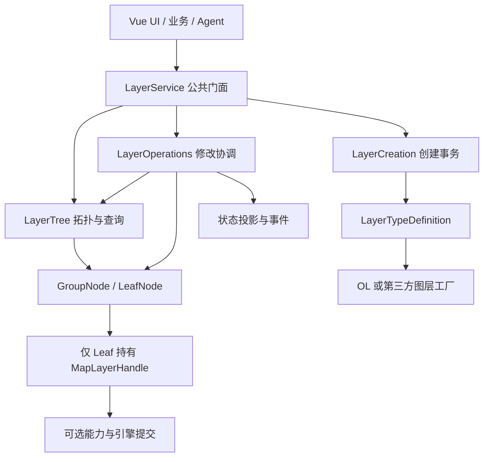

# create-gis-app 图层领域 P0 架构重构方案

> 范围：LayerService、LayerInstance、MapLayerHandle、LayerConfig，以及必要的 OL Adapter / Vue UI 迁移。  
> 基线：2026-11-26 GitHub main 静态审查；本文针对读取到的实现，不是已完成的重构。  
> 目标：通过明确的领域模型、单一写入路径、类型化能力组合和可扩展配置契约，使新增图层不必修改稳定的 Core 模块。  
> 约束：保留既有使用方式和行为测试，避免大规模重写、全局注册中心、IoC 容器及为设计模式而设计模式。

## 1. 执行摘要

| 编号 | 模块 | 当前问题 | 目标设计 | 优先级 |
| --- | --- | --- | --- | --- |
| P0-01 | LayerService | 706 行；创建事务、树关系、排序、事件、查询混杂 | 薄门面 + 内部 LayerTree + 创建事务 + 操作协调 | P0 |
| P0-02 | LayerInstance | 353 行；12 个构造参数、Group 递归、更新协议和能力代理耦合 | 小型实例对象 + 参数对象 + 单一修改路径 | P0 |
| P0-03 | MapLayerHandle | 大量可选方法；通用 OL Handle 依赖 VectorLayer | 基础渲染契约 + 类型化能力组合 + 统一提交协议 | P0 |
| P0-04 | LayerConfig | source/options 缺少按图层类型约束；校验分散 | Core 通用信封 + Adapter 专属类型/校验器 | P0 |

这里的 P0 指下一轮架构建设优先级，不意味着四项均已造成生产事故。优先修复可以由源码直接推导的语义问题，再做结构迁移。

## 2. 源码基线与证据

仓库：[flyFishHy/create-gis-app main](https://github.com/flyFishHy/create-gis-app/tree/main)。本轮读取的关键 blob SHA 如下，可用于 Codex 核对文件是否已变化（blob SHA 不是提交 SHA）。

| 文件 | Blob SHA |
| --- | --- |
| [layer-service.ts](https://github.com/flyFishHy/create-gis-app/blob/main/packages/core/src/layers/layer-service.ts) | `4760883d050329eb384ba787c133770f2c6f2c24` |
| [layer-instance.ts](https://github.com/flyFishHy/create-gis-app/blob/main/packages/core/src/layers/layer-instance.ts) | `050509e98d3855e5e85946ae62ff388f480a462b` |
| [types.ts](https://github.com/flyFishHy/create-gis-app/blob/main/packages/core/src/types.ts) | `3dfc134add1c9ee44fdb059d4ecff72380fce130` |
| [config/app-config.ts](https://github.com/flyFishHy/create-gis-app/blob/main/packages/core/src/config/app-config.ts) | `8bc8885fef2e63cbbfb586d1f7a794ec52b719e4` |
| [create-layer-handle.ts](https://github.com/flyFishHy/create-gis-app/blob/main/packages/adapter-ol/src/layers/common/create-layer-handle.ts) | `d058b43e54b61cad3064f26f8e701d41c9552fc6` |
| [UI layer-tree.ts](https://github.com/flyFishHy/create-gis-app/blob/main/packages/ui-vue/src/panels/layer-tree.ts) | `e03222102a0d09064d54cf132b04384d194c46fa` |

已有的资源作用域、异步创建暂存、逆序回收、版本检查、own/effective visibility、commitUpdate 回滚、不可变快照和观察者隔离都应保留。不要把已有修复重新列为未解决的缺陷。

## 3. 架构原则与目标目录

### 3.1 依赖关系



Core 不导入 Vue、OL；Adapter 实现 Core 契约；UI 只使用公开查询与修改 API。内部模块默认不从包根导出。LayerTree 不访问 AppContext、事件服务或引擎。

### 3.2 目标目录（建议，不要求机械拆文件）

```text
packages/core/src/
  layers/
    layer-service.ts          # 公共门面、注册和查询入口
    layer-instance.ts         # 公共只读视图及兼容方法转发
    layer-tree.ts             # 拓扑、身份、根/子节点顺序
    layer-node.ts             # Group / Leaf 内部状态模型
    layer-creation.ts         # 暂存、预留、创建、释放及回滚
    layer-operations.ts       # 修改、版本、事件、引擎提交协调
    layer-order.ts            # 排序计划纯函数
    layer-location.ts         # 范围验证与合并纯函数
    layer-capabilities.ts     # 类型化能力适配/受控代理
  types/
    layer.ts                 # LayerConfig / Update / Instance / Service
    layer-handle.ts          # 引擎 SPI
    layer-capabilities.ts    # capability 类型
    legend.ts                # 既有图例及样式契约
  config/
    app-config.ts            # 应用级验证
    layer-config.ts          # 通用图层配置验证
  types.ts                   # 兼容 barrel
packages/adapter-ol/src/layers/
  common/
    create-layer-handle.ts   # 基础 handle，无具体图层类型判断
    layer-update.ts          # 通用提交和回滚辅助
    layer-binding.ts
    layer-data.ts
  geojson/
    geojson-layer.ts
    geojson-config.ts
    vector-properties.ts
    vector-data-sync.ts
    vector-search.ts
    vector-styling.ts        # 从通用 handle 移出矢量专属逻辑
  xyz/                       # 各自 config + factory
  wms/
  wmts/
```

不强制每个文件使用 class。树/生命周期需要持有状态时使用 class；排序、范围合并和校验优先纯函数。不要再创建 LayerManager、LayerFactoryManager、LayerRegistryManager 等重复门面。

## 4. P0-01：LayerService 与 Group 领域模型

### 4.1 问题定位

- `instances`、`groupMembers`、`memberships` 分别维护实例和关系，Group 使用模拟 MapLayerHandle，Group/Leaf 语义混在一起。
- `addGroup().groupLeaves()` 从 `getMetadata().childIds` 反查后代；metadata 应是输出，不应作为拓扑输入。
- `LayerInstance.applyVisibility()` 又实现递归显隐，树规则跨两个类。
- `setOrder()` 先调用 adapter.setLayerOrder，再逐个设置 zIndex，部分失败可能使引擎与 Core 不一致；文档当前采用重新应用顺序作为恢复方式。
- `LayerManagerPanel` 和 `ui-vue/src/panels/layer-tree.ts` 从 metadata 重建树、计算叶子与排序。UI 需要公开领域查询，不应该重复领域规则。
- `addTree()` 已保证整树发布再通知，但 staged 和 parent 关联的失败路径、并发删除/重建仍需回归覆盖。

### 4.2 单一拓扑权威

采用判别联合而非 Group/Leaf 深继承。以下为目标类型示意，内部实现可按当前类型微调。

```ts
interface LayerNodeBase {
  readonly id: string
  readonly instance: LayerInstanceImpl
  parentId: string | null
}
interface GroupNode extends LayerNodeBase {
  readonly kind: 'group'
  children: LayerNode[]
}
interface LeafNode extends LayerNodeBase {
  readonly kind: 'leaf'
  readonly handle: MapLayerHandle
}
type LayerNode = GroupNode | LeafNode

class LayerTree {
  private readonly nodes = new Map<string, LayerNode>()
  private readonly roots: LayerNode[] = []
  // 内部 API：事务验证、挂载与移除、身份检查、遍历、排序计划
}
```

`nodes` 是 ID 索引，roots/children 是拓扑与兄弟顺序；必须由同一 LayerTree 原子修改。索引不是第二套领域状态。parentId 仅由树写入。创建事务中的暂存节点不进入已发布索引。所有操作按对象身份（或 generation token）验证，不仅按 ID，避免旧实例影响同名新实例。

公开查询建议：

```ts
interface LayerTreeItem {
  readonly id: string
  readonly kind: 'group' | 'leaf'
  readonly parentId: string | null
  readonly children: readonly LayerTreeItem[]
}
// 扩展现有 LayerService，不暴露内部可变节点
interface LayerTreeQueries {
  getTree(): readonly LayerTreeItem[]
  getChildren(id: string): readonly LayerInstance[]
  getLeaves(id: string): readonly LayerInstance[]
}
```

公开快照增加 `parentId`、`childIds`、`zIndex` 等稳定字段；旧 metadata.childIds/zIndex 可由树投影作为兼容别名，禁止再读取它们驱动内部逻辑。UI 可继续按 front-to-back 展示，Runtime 维持 back-to-front 契约。

### 4.3 创建事务与资源所有权

将 `addTree/addReserved/createLayer/releaseLayer` 提取到 LayerCreation，但保留既有 pending ID、任务追踪及失败清理语义。

```text
通用校验 → 全树类型校验/归一化 → 预留所有 ID
  → 顺序创建叶子 Handle（记录释放函数）
  → 建立暂存 Group/Leaf 节点
  → 计算初始有效显隐与排序
  → 确认父节点身份及应用仍可修改
  → 将叶子附着到引擎（记录尝试过的附着）
  → 原子发布拓扑和实例 → 刷新快照 → 发布领域事件
失败：逆序解除尝试过的附着，释放已创建资源，清除预留和暂存；保留原始 cause 与 cleanupErrors。
```

具体附着时机需结合 OL 工厂现有依赖测试确认；若必须提前附着，至少保证 Core 观察者不能读取半棵树，并明确这是领域原子性而非渲染引擎跨帧原子性。工厂自身负责在未返回 Handle 前的资源释放；Handle 返回后由创建事务接管。删除 Group 走树的后序遍历，不使用虚假 Handle.dispose。关闭应用时等待已经开始的创建/更新，拒绝新的写入。

### 4.4 显隐、排序和删除

- `ownVisible` 为用户独立设置；`effectiveVisible = ownVisible && ancestorsVisible`。关闭 Group 不改写子图层 ownVisible。
- 先计算所有受影响叶子的旧值和新值，再应用引擎；成功后提交领域状态和版本。失败时逆序补偿，补偿失败则报告不一致，不宣称成功。
- Group 自身不拥有引擎 Handle。Group 范围是有效叶子范围合并，隐藏图层仍可定位；混合投影沿用现有拒绝规则，不由 Core 暗中投影。
- 现有 `setOrder(ids)` 兼容完整 ID 排序；新增 `move(id, targetId, position)` 可选，先不支持跨父节点重挂。显式排序将叶子 zIndex 归一为 0..N-1；初始配置允许既有 zIndex 语义（含 Group 区间），不能默认把历史重叠兄弟顺序静默改写。排序策略应明确区分初始排序与用户显式排序。
- 为排序生成完整 plan，保存旧引擎顺序、旧 zIndex；成功后发布新拓扑/排序。若引擎无法提供原子排序，使用补偿协议并报告失败；临时绘制/高亮图层不参与业务排序。
- Group 创建仍要求至少一个子节点，与现有 Schema 一致；运行时删除最后一个子节点后允许空组。空组是否可通过配置恢复留待独立持久化需求，不在本次偷偷改契约。

## 5. P0-02：LayerInstance 与统一写入路径

### 5.1 现状和风险

当前构造函数有 12 个参数，其中四个是行为回调。`LayerInstance` 同时实现自身状态、组递归、更新队列、适配器转发、资源释放与事件协调。`update()` 异步排队，但 `setVisibility`、时间/图例过滤是同步写入；当 legacy 异步 Handle.update 正在等待时，存在操作交错及旧 patch 覆盖新状态的风险，需要故障注入验证。`update(patch)` 当前直接捕获调用方 patch 引用，若排队前后调用方修改对象，执行内容可能变化。

### 5.2 实例是稳定的领域视图，不是第二个 Service

```ts
interface LayerInstanceOptions {
  readonly config: NormalizedLayerConfig
  readonly identity: LayerIdentity
}
interface LayerMutationPort {
  update(identity: LayerIdentity, patch: LayerUpdate): Promise<void>
  setVisibility(identity: LayerIdentity, visible: boolean): void
  remove(identity: LayerIdentity): Promise<void>
  // 旧能力方法通过同一受控端口转发
}
class LayerInstanceImpl implements LayerInstance {
  constructor(
    private readonly options: LayerInstanceOptions,
    private readonly mutations: LayerMutationPort,
    // 可使用内部节点状态的只读 reader，而不是再次复制状态
  ) {}
}
```

这是结构示意而非可直接编译的完整实现。内部节点持有已提交状态；实例 getter 读取该状态，Service 与实例的公开修改方法都调用同一个 Operations 入口。不要让 Operations 再调用实例的公开 update 导致循环。内部 raw Handle 只供 Core 协调及 Adapter 使用，不暴露给业务。实例身份可用不可伪造的内部 token，避免同名重建造成旧引用写入新层。

### 5.3 修改协议

```text
捕获不可变 patch → 验证生命周期/身份 → 入队（异步操作）
→ 执行时检查 expectedVersion → 生成领域及引擎更新计划
→ 引擎提交/补偿 → 领域状态提交 → 版本递增 → 快照刷新 → 事件发布
```

- `expectedVersion` 不传给 Adapter；失败不发布成功事件，不增加版本；保持已有 no-op 版本行为直到单独定义变更。
- 校验并复制 JSON patch 在入队时完成；执行时再检查身份、状态和版本。
- 本轮保留同步 `setVisibility` 与同步过滤 API；如同层存在正在执行的 legacy 异步更新，明确拒绝同步写入（结构化 busy 错误）或迁移后统一同步提交。不可默默把同步方法变成异步。涉及 Group 的同步操作必须检查受影响所有叶子。
- 对既有同步 commitUpdate，无 await 的提交过程内不可插入其他修改；异步准备阶段不得修改引擎。旧异步 update 仅兼容，不能宣称具备完全原子性。
- 删除先使身份失效/禁止新写入，再等待在途任务，释放资源。失败清理后不得复活旧实例。
- 将 `batchMutation` 中的非空断言 `mutationEvents!` 改为明确的操作上下文或内部事件收集器；禁止事件回调期间误写入已结束事务。观察者异常不回滚成功操作。

### 5.4 状态与 metadata

通用状态：id/type/title/status/version/ownVisible/effectiveVisible、parentId、childIds、zIndex；若支持 opacity，定义明确的可选领域属性（未知不是 0）。style/legend 的当前配置与引擎解析后的展示结果必须区分，避免从解析后的 legend 反推原始配置。metadata 只容纳引擎附加信息，不得覆盖领域 id/type/title。暂不建设完整配置持久化，但为未来 exportConfig 保留规范化配置与已提交修改的读取来源。

## 6. P0-03：MapLayerHandle 类型化能力组合

### 6.1 现状

`MapLayerHandle` 将 identify、字段查询、样式、图例过滤、时间过滤、范围以及基础渲染能力放在同一个接口。LayerInstance 再逐一代理，增加能力需改多个文件。`createLayerHandle` 无论 XYZ 还是 GeoJSON 都初始化 styling，还使用 `instanceof VectorLayer` 判断，限制 VectorTile/WebGL/Heatmap 扩展。通用 options 校验只允许 opacity。

### 6.2 设计：基础 SPI + 小接口组合

保留基础可见性、排序、释放、提交；不把业务需要的每个能力塞进基础接口。读能力与写能力区分，写入必须通过 Operations。

```ts
export interface LayerFeatureCapability {
  getFields(): readonly LayerField[]
  getFieldValues(field: string): readonly LegendValue[]
  canSelectFeature?(ref: FeatureReference): boolean
  identify?(query: LayerIdentifyQuery):
    readonly LayerIdentifyHit[] | Promise<readonly LayerIdentifyHit[]>
}
export interface LayerTemporalCapability {
  getDimensions(): readonly LayerTimeDimension[]
  getFilter(): LayerTimeFilter | undefined
  setFilter(filter: LayerTimeFilter | undefined): void
}
export interface LayerLegendCapability {
  resolve?(legend: LegendDefinition): LegendDefinition
  supportsFilter(): boolean
  getFilter(): string | undefined
  setFilter(ruleId: string | undefined): void
}
export interface LayerLocationCapability {
  getDataLocation(): MapLocation | undefined
}
export interface LayerStyleCapability {
  getStyle(): LayerStyle | undefined
}
export interface LayerCapabilities {
  feature: LayerFeatureCapability
  temporal: LayerTemporalCapability
  legend: LayerLegendCapability
  location: LayerLocationCapability
  styling: LayerStyleCapability
}
export interface MapLayerHandle {
  setVisible(visible: boolean): void
  setZIndex(zIndex: number): void
  dispose(): void | Promise<void>
  commitUpdate?(patch: EngineLayerPatch): undefined
  readonly capabilities?: Readonly<Partial<LayerCapabilities>>
  getMetadata?(): Readonly<Record<string, unknown>>
}
```

`EngineLayerPatch` 从公共 LayerUpdate 排除 expectedVersion 等领域字段；Group 操作不传给 Handle。各能力内部成员是否可选，按真实语义拆分；例如仅支持远程 identify 的图层不应被迫实现字段枚举，可进一步将 feature 拆成 identify 与 attributes 两个小接口。上例为迁移草图，不要求强制实现所有成员。

### 6.3 业务侧 API 与扩展边界

第一阶段保留 `layer.getFields()`、`layer.setTimeFilter()` 等已发布方法，内部调用能力适配器，不再直接读取散落的 Handle 方法。提供类型化 `getCapability<K extends keyof LayerCapabilities>(key: K)` 时，返回的是受控公共 facade，而不是 raw adapter capability。公共与 SPI 类型可以分开命名，避免误用。读操作遵守 disposed 语义；写操作校验身份、生命周期、版本，执行后刷新状态并发送通知。`supportsFilter()` 可能随图例改变，不能只在创建时缓存。

可选自定义能力未来使用 TypeScript interface declaration merging 或显式泛型注册；本轮不引入字符串任意方法执行、全局能力注册中心、自动反射或 Agent 协议。内置能力列表扩展时只改能力契约与消费者，不改核心创建流程。

### 6.4 统一更新协议

现有 `commitUpdate` 优先，legacy `update` 次之，基础 setVisible/setZIndex 补充的方式会导致协议分叉。目标是所有内置 OL Handle 提供同步 `commitUpdate`，保证失败时尽可能恢复自身引擎状态；仍保留两个基础 setter 供树显隐/排序使用，但同一操作不能重复提交。

迁移阶段在唯一 `normalizeLayerHandle()` 内转换旧 flat 方法、legacy update；业务代码不应到处写 `if (commitUpdate) ... else ...`。对于不支持的 style/options 应明确报错，而不是忽略。legacy 异步路径标为兼容且增加测试，不强制伪装为同步。若回滚失败，聚合原始错误及补偿错误并标记需重新同步，不声称完整 ACID 事务。

### 6.5 OL 组合方式

```ts
// 示意：基础 handle 不 import VectorLayer、Feature 或 GeoJSON
const base = createBaseLayerHandle(olLayer, config, {
  dispose: () => resources.dispose(),
  prepareSpecificUpdate: prepareGeoJSONStyleUpdate,
})
return {
  ...base,
  capabilities: {
    styling: vectorStyleCapability,
    feature: vectorFeatureCapability,
    temporal: vectorTemporalCapability,
    legend: vectorLegendCapability,
    location: vectorLocationCapability,
  },
}
```

基础 Handle 负责 opacity/visible/zIndex 等通用引擎操作；图层特定更新通过策略传入，先准备所有变更，再统一提交和补偿。XYZ/WMS/WMTS 无需经过 Canvas Vector 样式控制器。保留 OL LayerBinding 与 writableTarget 的现有所有权，不能通过 object spread 意外丢失必须的闭包绑定或释放函数。GeoJSON 的时间、图例过滤必须继续影响渲染、搜索及拾取，不能各维护独立筛选规则。

## 7. P0-04：LayerConfig 的类型与校验体系

### 7.1 问题定位

Core 的 `LayerConfig` 使用 `type: string`、`source?: JsonValue`、`options?: Record<string, JsonValue>`。这是开放插件体系需要的通用信封，但直接用作所有内置图层的业务类型会丢失类型提示。Core 已检查 children 仅 GROUP 可用、GROUP 非空等通用规则；问题在于各图层专属 source/options 校验散落在工厂中，且错误往往没有一致路径。

### 7.2 双层契约，不封死插件扩展

```ts
// Core：保留开放 JSON 输入，作为外部配置/插件边界
interface LayerConfig {
  readonly id: string
  readonly type: string
  readonly title?: string
  readonly visible?: boolean
  readonly zIndex?: number
  readonly style?: LayerStyle
  readonly legend?: LayerLegend
  readonly source?: JsonValue
  readonly options?: Readonly<Record<string, JsonValue>>
  readonly children?: readonly LayerConfig[]
}

// Adapter：为开发者提供准确类型（字段应以现有工厂为准）
type XYZLayerConfig = Omit<LayerConfig, 'type' | 'source' | 'options' | 'children' | 'style'> & {
  readonly type: 'xyz'
  readonly source: XYZSourceConfig
  readonly options?: XYZOptions
  readonly children?: never
  readonly style?: never
}
```

`XYZSourceConfig`、`XYZOptions` 应从当前 xyz-layer.ts 的实际字段抽取，不凭空设计新的 source 参数。GeoJSON/WMS/WMTS 同理；source 的专属类型可采用 discriminated union。Adapter 导出 `OLLayerConfig` 联合以及各类型；业务使用 `satisfies XYZLayerConfig` 或 `satisfies OLLayerConfig` 检查内置配置。仅导出联合不会自动让现有 `app.layers.add(LayerConfig)` 获得窄类型提示，文档需如实说明。不要使用 `KnownConfig | LayerConfig` 假装得到严格类型检查，宽分支会吞掉错误。

若未来希望 `app.layers.add()` 自动推导插件类型，可另行评估泛型 GISApp/LayerService 或模块增强；本轮不把泛型传染整个 Runtime。

### 7.3 LayerTypeDefinition 持有类型专属校验

```ts
interface LayerTypeDefinition<TConfig extends LayerConfig = LayerConfig> {
  normalize?(config: LayerConfig): TConfig
  create(context: AppContext, config: TConfig):
    MapLayerHandle | Promise<MapLayerHandle>
}
```

normalize 为纯同步校验/归一化，不能请求数据或创建引擎对象。注册边界使用泛型闭包将 normalize 与 create 绑定；内部存储擦除类型时只能在该边界进行受控转换，不把 `as any` 分散到各工厂。若注册类型定义了窄 TConfig，应通过 helper 要求其提供 normalize，不能未经校验直接强转。兼容旧 definition 时默认接受已通过通用校验的 LayerConfig。

示意：

```ts
const definition = defineLayerType({
  normalize: normalizeXYZConfig,
  create: createXYZHandle,
})
app.registerLayerType('xyz', definition, resources)
```

`defineLayerType` 只是可选类型推断辅助函数，不需要新增运行时 Registry class。

### 7.4 验证顺序与错误约定

1. `parseGISAppConfig` 继续负责不依赖插件的 JSON 结构与通用领域规则。
2. `app.init` 安装插件后、创建初始图层前，对完整树做类型专属预检；动态 add/addChild 调用同一校验管线。
3. 通过注册表查找 type，未知 type 报 `LAYER_TYPE_NOT_FOUND`；专属字段错误报 `CONFIG_INVALID` 并携带 layerId、path、原因。
4. 校验后得到冻结的配置快照，保留配置身份 id/type；插件 normalize 不得更改拓扑或身份。外部对象之后修改不影响执行。
5. options 更新由对应 Handle/类型策略验证；不得把创建 schema 当成更新 schema。非法属性、非法数值在引擎写入前拦截。
6. 外层扩展字段保持现有兼容策略；内置 source/options 是否拒绝未知字段，逐个对照既有行为，若收紧则记录迁移。不可将开放插件信封全局设置 additionalProperties:false。

`schemas/gis-app-config.schema.json` 保留通用结构验证，内置类型可用条件 schema 或独立 Adapter schema 补充；不复制多套无一致性测试的规则。现有 Ajv 测试可用于 JSON Schema 与 TS runtime 校验一致性检查，无需为此次任务强制增加 Zod 等依赖。

## 8. 现有 API 与调用方迁移

| 调用方 | 处理方式 |
| --- | --- |
| `app.layers.add/addChild/get/list/update/remove` | 签名保持；内部转交 Creation/Tree/Operations |
| `layer.update/setVisibility/dispose` | 保留，统一受控修改入口 |
| `getFields/getTimeDimensions/setTimeFilter` 等 | 保留为兼容 facade，内部调用能力 |
| `MapAdapter.addLayer/removeLayer/setLayerOrder` | 保留；只接收 Leaf handle |
| `createOLLayerHandle` | 保持公开入口；新增可选能力/专属更新策略，默认行为需回归 |
| `LayerManagerPanel` / `layer-tree.ts` | 改用正式拓扑查询和强类型快照，去掉 metadata 反查 |
| `LegendPanel/LayerEditor/TimePickerPanel` | 先保留公开方法，后续渐进使用能力 facade |
| `workspace-config.ts` | 保持现有保存范围；用 ownVisible 与正式树字段替换错误来源，完整持久化另立任务 |
| `ol-vue` / 外部插件模板 | 测试兼容注册、绘制测量、选择及资源释放 |

UI 重构限于 P0 契约所需改动，不在本次迁移整个 Feature 目录、重做图例编辑器或 UI 布局。

## 9. 分阶段实施计划（建议 5 个独立 PR）

| PR | 工作 | 验收与回退边界 |
| --- | --- | --- |
| 1 | 固化现有语义，补故障测试；参数对象、patch 捕获、类型文件整理 | 公共 API 不变；修复与结构调整分提交 |
| 2 | 引入内部 LayerTree、Group/Leaf、创建与删除事务 | 无模拟 Group handle；旧 UI 契约兼容；整树测试通过 |
| 3 | 统一 Operations、显隐级联、排序补偿、快照字段；迁移 UI 树读取 | 同一操作仅一条写入路径；失败语义验证 |
| 4 | 能力接口组合、legacy Handle 适配、OL base/vector 分离 | 现有四种图层和绘制测量功能不退化 |
| 5 | 专属配置类型/normalize 管线；自定义图层扩展验证；文档 | 无效配置预检；Heatmap 验证 fixture；全量质量门禁 |

每个 PR 可独立合并且通过测试。若 main 已有相关修改，先对照本方案验收条件而非机械覆盖。不要同时删除旧 API 与迁移所有插件；兼容入口集中在一个边界，待下一明确版本再移除。

## 10. 测试与验收矩阵

建议在现有 `packages/core/test`、`packages/adapter-ol/test`、`packages/ui-vue/test` 中补用例，避免重复已有测试。优先扩展 fake-map 进行故障注入。

| 类别 | 必测用例 |
| --- | --- |
| 拓扑 | 多层 Group、子节点顺序、动态 addChild、删除最后子节点、同名 ID 重建、旧实例拒绝写入 |
| 创建 | 子层创建失败、部分 attach 后失败、rollback 失败、父组删除期间 addChild、并发重复 ID、dispose 与 init/add 交错 |
| 显隐 | Group 隐藏/恢复保留独立偏好；隐藏父组下新增子层；子层更新；中间叶子 setter 抛错后补偿 |
| 排序 | 兄弟移动、Group 整块排序、临时层保留、非法 ID/重复 ID、引擎排序失败及第 N 个 zIndex 写入失败 |
| 更新 | stale expectedVersion、调用者修改 queued patch、异步 legacy 与同步写入交错、部分失败时无成功事件、更新期间删除 |
| 能力 | XYZ 无矢量能力；GeoJSON 有正确能力；不支持写入报错；disposed facade 拒绝写入；图例/时间筛选与拾取搜索一致 |
| 配置 | 所有内置类型合法/非法 source；children 禁止于 Leaf；不合法 options；初始化与动态创建一致；类型专属预检不创建引擎资源 |
| UI | 通过正式树契约显示层级；排序、定位、显隐和图例不退化；元数据同名字段不能改变拓扑 |
| 生命周期 | 资源逆序释放、重复 dispose、插件资源清理、观察者抛错不阻止其他订阅者 |
| 类型 | `@ts-expect-error` 验证专属配置错误；公开导出、插件模板 typecheck；无新增不必要 any |

质量门禁：`pnpm check`；额外运行 `pnpm lint:quality` 并记录存量告警与新增告警。必要时启动 `examples/basic-vue`，实际验证 Docked/Overlay、搜索、测量、图例与图层管理。不得为测试通过而放宽断言或吞异常。

## 11. 扩展性验收：新增 Heatmap 类型

不要求本轮完成产品级热力图，只需要一个真实的小型 Adapter 扩展或测试 fixture，验证：

```text
adapter-ol/src/layers/heatmap/
  heatmap-config.ts
  heatmap-layer.ts
  heatmap-update.ts  # 仅复杂时才独立
```

- 注册专属类型，配置 radius/blur 等实际支持的参数；非法输入在写入引擎前拒绝。
- 可用统一图层管理显隐、排序、删除；不强迫热力图实现矢量样式或时间过滤。
- 专属 update 使用自身策略且支持失败补偿。
- 不修改 GISAppImpl、LayerService、LayerInstance、AppState、MapAdapter 的通用实现；只允许增加工厂、类型定义、注册装配、必要公开导出与测试。若需要全新的专属 UI 面板，其新增 UI 扩展属于合理改动，不属于扩展失败。
- 再用一个第三方 mock layer（非 OL）验证 Core 不依赖任何 OL 类型。

验收不是代码行数越少越好，而是变更边界可预测、状态权威唯一、失败行为清楚。

## 12. 明确不做的事情

- 不引入大型 IoC、Event Sourcing、全局 CommandBus、RxJS、Redux 或第二套状态容器。
- 不在 Core 内写死 XYZ/WMS/WMTS/Heatmap 等具体引擎图层类型。
- 不把 Group 实现成假 MapLayerHandle，也不让 metadata 成为领域输入。
- 不把 raw capability 暴露给业务绕开版本和生命周期检查。
- 不承诺跨引擎完全原子事务；补偿失败必须可观察。
- 不因目录美观而拆出大量只有一次调用的小函数或 Manager。
- 不同时进行完整持久化、Agent Actions、AppState 性能改造及全量 UI 重构。

## 13. 给 Codex 的实施指令

```text
请基于 create-gis-app 当前 main，按照本文实施图层领域 P0 重构。
先阅读 .agents/skills/gis-runtime/SKILL.md、doc/runtime-api.md、
doc/create-gis-app-runtime-api-design.md、doc/vue-ui-api.md 及现有测试。
核对本文源码基线；如 main 已变化，先列出现状差异并调整方案。

原则：LayerTree 是唯一拓扑权威；Group 不拥有引擎 Handle；
LayerService 和 LayerInstance 走同一修改协调路径；
MapLayerHandle 基础契约 + 类型化能力组合；具体配置由图层类型校验。
保留 public API 和已存在的行为契约，不引入复杂框架，不做无关 UI 改造。

按第 9 节分批实施。先补回归和故障注入测试，再重构。
每批提交前执行 pnpm check，额外检查 lint:quality，记录失败原因。
同步 API reference、设计文档和 JSON Schema（若契约变化）。
最终使用 Heatmap 和第三方 mock layer 验证扩展性。
输出：变更文件、设计决策、兼容性、测试结果、已知限制和后续待办。
不得声称未运行的测试通过，不得以删除测试、宽化类型、吞异常换取绿灯。
```

## 14. 审查限制

本文依据 GitHub main 的关键源文件静态阅读，并未 checkout 完整仓库运行 `pnpm check`、浏览器或故障注入测试。设计中的接口和目录是目标草图，不是已经编译验证的补丁。尤其排序补偿、同步/异步写入冲突、暂存资源与父节点竞态，需要通过测试确认具体行为和实现可行性。实施前应以最新 main 和现有公开契约为准。
