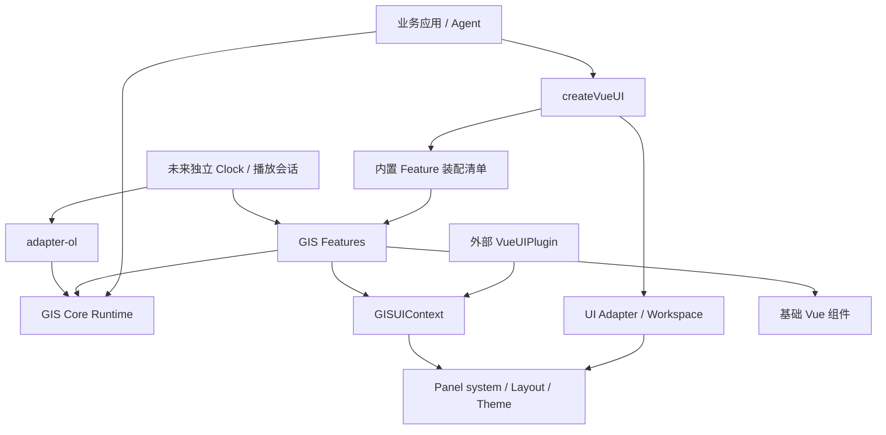

# create-gis-app · ui-vue 架构审查与渐进式重构方案

> 版本：V1.0 · 2026-11-27
> 基线：GitHub main，读取到的 Git tree `6d8a97cb48851743c567ba13e978c9b38b0cf513`（不是 commit SHA）。
> 范围：UI 子系统架构、面板、布局、生命周期、响应式桥接、配置、功能模块及时间组件扩展。
> 状态：设计与实施计划，尚未修改仓库或执行测试。与《create-gis-app 图层领域 P0 架构重构方案》配套使用。

## 1. 结论与目标

ui-vue 已具备框架无关 Runtime、UIAdapter、VueUIPlugin、PanelRegistry、可替换布局、主题服务及状态快照等基础。问题不在于 Vue 选型，而在于扩展点与内置功能尚未彻底解耦：通用面板宿主知道业务 ID，根组件知道特定面板的位置，Adapter 持有业务时间状态，配置和默认注册存在重复定义。未来 Timeline、轨迹回放及空间分析会放大这些耦合。

重构目标：

- 保留 `createVueUI()`、GISWorkspace、自定义布局、现有面板注册、主题配置及包根公共 API。
- UI 框架不依赖 OpenLayers，不保存 GIS 领域状态的第二份真相。
- 新增普通 GIS 功能只新增 Feature 文件和装配入口，不修改 VueUIAdapter、PanelHost、GISUIRoot 的业务分支。
- 内置功能与第三方扩展使用同样的面板注册能力；不引入新的插件管理框架。
- 时间选择、时间轴、播放时钟各自独立；首版限制复杂度，不建设通用时空平台。
- 按行为变化分批提交，不以代码行数、文件数量作为验收依据。

P0 指当前架构优先级，不等价于生产事故。先保证已有行为，再迁移设计。

## 2. 基线与证据

仓库：<https://github.com/flyFishHy/create-gis-app/tree/main/packages/ui-vue>。

以下为本轮及紧邻前轮实际读取的文件。实施者须先核对本地 main，若 P0 Core 已合并，以实际公开契约为准，不重复实现。

- `src/vue-ui.ts`：441 行，blob `42d1bfef9ebaa480d20257e0c4372b811d335046`。
- `src/GISUIRoot.vue`：250 行，布局、主题、键盘、面板挂载。
- `src/GISWorkspace.vue`：62 行，blob `1fa78714e599728851888d2f04cfa4e8217129ab`。
- `src/panels/panel-registry.ts`：134 行，面板定义和状态。
- `src/components/PanelHost.vue`：101 行，面板渲染和 ID 特判。
- `src/components/PanelRegion.vue`：29 行，区域过滤。
- `src/layouts/DashboardLayout.vue`：88 行，两套布局及 Teleport。
- `src/workspace-config.ts`：78 行，blob `e9d5d9d7a8444e69ff95eb07fd671bbc2b963309`。
- `src/panels/LayerManagerPanel.vue`：454 行，树、透明度队列、拖拽。
- `src/panels/LegendPanel.vue`、`LayerEditor.vue`：图例、编辑版本、初始值。
- `src/components/time-picker/TimeFilterPicker.vue`：469 行；`time-period.ts`：142 行；`TimePickerEndpoint.vue`：约 6.7 KB。
- `src/panels/TimeController.vue`：89 行，实质是受控 Slider，并非播放时钟。
- `src/services/locale-service.ts`：445 行，blob `82983a0abc36dd4d7bb9c95a0ec67f48ee87b885`。
- `src/services/theme-service.ts`、`toolbar-service.ts`、`use-app-state.ts`、`use-panel-header.ts`、`index.ts`、`types.ts`、`config.ts`。
- `packages/core/src/types/ui.ts`、`types/app.ts`；`doc/timeline-design.md`（3785 行，前瞻设计而非现有实现；本轮未逐行审计全文）。

链接采用 `https://github.com/flyFishHy/create-gis-app/blob/main/packages/ui-vue/` 加相对路径。Blob SHA 用于确认文件版本，不能当提交 ID 使用。

## 3. 问题清单（按实施优先级）

| ID | 优先级 | 现状 | 影响 |
|---|---|---|---|
| UI-01 | P0 | Adapter 集中装配、注册、持久化、属性策略、时间状态 | 新功能修改基础设施 |
| UI-02 | P0 | PanelHost 特判 layer-manager/legend/properties；PanelRegion 排除 toolbar/status | 扩展机制存在内外差异 |
| UI-03 | P0 | Root/Layout 硬编码属性抽屉、底部状态栏、工具提示 | Timeline 等宽幅组件布局受限 |
| UI-04 | P0 | builtinPanels 与 registerDefaultPanels 重复；位置规则散落 | 默认值漂移、配置优先级难推理 |
| UI-05 | P0 | 注册/卸载、独立 mount/嵌入 host、隐藏重挂载策略需明确 | 资源泄漏及竞态风险，需测试确认 |
| UI-06 | P0 | TimeSelection 直接由 Adapter 持有并硬编码到快照 | 时空功能扩展需要修改 Adapter |
| UI-07 | P1 | UI 依赖 metadata.childIds/opacity/zIndex，重复树遍历 | Core/UI 隐式契约、领域逻辑泄漏 |
| UI-08 | P1 | Snapshot、事件 revision、实时实例读取混用 | 响应式难推理、冗余计算 |
| UI-09 | P1 | 工作区导出仅遍历初始 config，使用 effective visible | 动态图层遗漏、恢复显隐错误 |
| UI-10 | P1 | LegendPanel computed 内记录首次读取样式 | reset 基准随 UI 生命周期变化 |
| UI-11 | P1 | TimePicker 多模式、弹窗和时间业务混合 | 维护成本较高，非所有功能都必要 |
| UI-12 | P1 | 大型 SFC、全局 SCSS、功能横向分散 | 修改范围大、复用困难 |
| UI-13 | P1 | locale 仅固定词典，服务及资源混合 | 第三方扩展国际化不便 |
| UI-14 | P1 | Theme/Locale 监听器与 Vue ref 双路径，异常隔离不统一 | 观察者失败可能影响调用者 |
| UI-15 | P2 | 包根导出内部实现、旧占位组件，依赖体积需测量 | API 稳定成本、构建负担 |
| UI-16 | P1 | TimeController 命名与真实行为不符；Timeline 设计范围过大 | 未来播放系统职责混淆 |

UI-01~04、06~11 可直接从现有代码观察；UI-05、14、15 的具体故障及性能影响需要通过测试/构建确认，不应宣称已复现。

## 4. 整体架构与依赖规则



图表示主要协作关系而非严格 npm import 方向。实际依赖：`adapter-ol -> core`、`ui-vue -> core`；二者互不依赖；可选 `ol-vue` 可依赖两者。本轮不移除 ol-vue，不强制抽象绘制测量结果接口。

约束：

1. Core 不导入 Vue、Element Plus 或 UI 实现；ui-vue 不导入 OL 原生对象或 Adapter 私有控制器。
2. Feature 通过公共 GISApp / AppContext 读写领域状态，通过 GISUIContext 使用 UI 基础设施。
3. 基础组件可独立使用，不调用 useGISApp；GIS Feature Panel 负责业务绑定。
4. panel-system、layout 不 import 具体业务 Feature；唯一允许集中 import Feature 的地方是装配清单。
5. 不新增全局 FeatureManager、CommandBus、IoC、全局时间总线；不引入 Pinia 复制 Runtime 状态。
6. Feature 不通过另一个 Feature 的内部实现共享状态；真正共享的状态归属于其明确所有者，通过小接口传递。

## 5. 目标目录（按实际需要创建）

```text
packages/ui-vue/src/
  index.ts                         # 稳定公共 API / 兼容导出
  types.ts                         # 兼容类型入口
  adapter/
    vue-ui.ts                      # createVueUI 插件入口
    vue-ui-adapter.ts              # mount/unmount/dispose、host 协调
    create-ui-context.ts           # 创建 UI 基础服务
    builtin-features.ts            # 默认功能装配清单
  workspace/
    GISUIRoot.vue
    GISWorkspace.vue
    WorkspaceHeader.vue
    workspace-config.ts
    workspace-persistence.ts
    ui-state-contributor.ts
    use-workspace-shortcuts.ts
  panel-system/
    panel-registry.ts
    panel-types.ts
    PanelHost.vue
    PanelRegion.vue
    PanelShell.vue
    use-panel-header.ts
    panel-size.ts
  layouts/
    DashboardLayout.vue
    DockedDashboardLayout.vue
    OverlayDashboardLayout.vue
    layout-regions.ts
  features/
    layer-manager/                 # 面板、行、拖拽、查询
    legend/                        # Legend、Editor、编辑会话、局部样式
    search/
    properties/
    feature-picker/
    toolbar/
    map-status/
    appearance/
    time-picker/                   # 基础组件与 GIS 绑定
    timeline/                      # 后续实际开发时创建
  components/                     # Select、Switch、Tooltip、ScrollArea、SvgIcon
  composables/                    # use-app-state、use-gis-app、use-gis-ui
  services/                       # 通用 UI 服务，保持小规模
  theme/                          # token、主题变量、纯颜色函数
  locales/                        # zh、en，按实际需要拆分
  styles/                         # 全局基础样式、布局、共享 token
  assets/
```

不强制每个 Feature 都有 install.ts、types.ts、composables/。一个简单面板只需要组件和必要的注册函数。目录迁移和行为改变尽量分开提交。

## 6. P0-1：UIAdapter 装配与生命周期

### 6.1 现状

`VueUIAdapter` 构造函数解析配置、创建服务、注册面板/工具栏、订阅 selection；`registerState` 同时建立快照、watch 和 localStorage 保存；`installExtensions` 收集 cleanup。`GISWorkspace` 在 setup 绑定 host，再调用 Runtime mount。保留这些能力，但分离所有权。

### 6.2 目标设计

- createVueUI：解析配置，创建 UI 实例，注册 UIAdapter，安装内置 Feature 与外部扩展，注册快照。失败由资源作用域逆序回收。
- VueUIAdapter：只维护 standalone VueApp 与 embedded host 的互斥关系，负责 mount/unmount/dispose。
- UIContext：提供 panel、toolbar、theme、locale、featureRenderers 等服务；不新增每个功能专属字段。
- WorkspaceState：投影 UI 偏好，不直接读取图层内部对象。
- Feature 安装函数：注册组件及自己所需的订阅、行为策略；返回幂等 cleanup。

示意（签名为建议，不是现有 API）：

```ts
export function createVueUI(options: VueUIOptions = {}): GISPlugin<VueUIOptions> {
  return {
    name: 'gis-vue-ui',
    install(runtime, pluginOptions, resources) {
      const resolved = resolveVueUIOptions(options, pluginOptions, runtime.config?.ui)
      const ui = createUIContext(runtime, resolved)
      const adapter = createVueUIAdapter(ui, resolved)
      // 所有拥有的资源必须进入 scope；结合 Core 的注册契约避免重复 dispose。
      runtime.registerUIAdapter(adapter, resources)
      installBuiltinFeatures(ui, resolved, resources)
      installUIExtensions(ui, resolved.extensions, resources)
      registerUIState(ui, runtime, resources)
    }
  }
}
```

实际实现需保持当前 `pluginOptions ?? options` 优先级或明确兼容迁移；不要未经验证改成深度 merge。现有 ResourceScope 工厂待 Core P0 完成后使用，禁止直接引入 Core 私有实现。Adapter 自身及安装资源必须确定唯一所有者，避免资源在 adapter.dispose 与 Core scope 中各清理一次。

### 6.3 生命周期不变量

- 每个 GISApp 至多一个 UIAdapter、一个活动 host；多 GISApp 互相隔离。
- 独立 mount 与 GISWorkspace 嵌入模式互斥。卸载只解绑 UI 和 map target，不销毁业务数据或播放会话。
- 部分安装失败必须回滚已安装 Feature、注册项、订阅、watch，清除 WeakMap 映射；构造函数避免不可逆副作用。
- mount 失败后可按现有 Runtime 状态契约重试；dispose 幂等；dispose 后不能再挂载。
- GISWorkspace 的 app prop 若不支持动态替换，明确约束为稳定引用并用 key 重建；不要假设 setup 会自动重新绑定。
- MapViewport 旧实例卸载不得误清除新实例 target。布局切换时优先稳定挂载 map，必要时使用 owner token/当前 target 检查，避免双重 detach；实际选择依据 MapService 契约。
- 清理时继续处理剩余资源，汇总错误；保持已有 app:error 语义。

## 7. P0-2：Panel System 真正通用化

### 7.1 问题证据

PanelHost 根据 `['layer-manager', 'legend']` 决定 badge 和 refresh，并特判 properties 图标和动画。PanelRegion 排除 toolbar/status。`usePanelHeader` 已能通过注入提供 header 信息，但没有完全用于通用渲染。PanelRegistry `setOrder` 允许部分 ID，可能与未移动项重复；状态 ref 可写。隐藏时 v-if 销毁，折叠时的行为取决于 shell。

### 7.2 最小契约调整

优先复用现有 `icon`、`unframed`、`closable`、`collapsible`，不重复创建 header.visible 与 unframed 两套语义。只补齐实际缺口：

```ts
interface VuePanelDefinition extends PanelDescriptor {
  readonly component: Component
  readonly props?: Readonly<Record<string, unknown>>
  readonly icon?: string
  readonly unframed?: boolean
  readonly closable?: boolean
  readonly collapsible?: boolean
  readonly allowedPositions?: readonly PanelPosition[]
  readonly keepMounted?: boolean
  readonly header?: {
    readonly badgeLabel?: string
    readonly refreshLabel?: string
  }
  // 现有 width/minWidth/maxWidth/height 等字段保留
}
```

不在首版新增通用 slot registry 或复杂 actions DSL。Header 的动态 badge、refresh 由现有 `usePanelHeader` 提供，通用 Host 根据是否存在 badge/refresh 渲染。若确有自定义 header 需求再增加 component slot。

```ts
ui.panels.register({
  id: 'layer-manager', title: 'panel.layers', icon: 'layers',
  component: LayerManagerPanel, position: 'left',
  header: { badgeLabel: 'layer.count', refreshLabel: 'layer.refresh' },
  defaultVisible: true, collapsible: false, closable: false,
})
```

PanelHost 不再出现任何 GIS 业务 ID 判断。动画由布局宿主或配置传入；状态、定义变化均应有明确响应式来源。

### 7.3 状态与排序

- 注册定义（组件、props、策略）和运行状态（visible/collapsed/order/position/size）分离；状态仅通过服务方法修改。
- `states` 内部可用 shallowRef，外部 readonly 视图；公开 `getState/list` 保持兼容。
- 明确 `setOrder(ids, position)` 为指定区域完整排列；若既有消费者依赖部分排序，先保留并定义为稳定合并后归一，提供测试，不默默改变语义。
- 注册清理句柄检查定义身份，防止旧 cleanup 删除同 ID 的新注册项。
- `allowedPositions` 由定义声明，配置校验统一在 registry/装配阶段处理；兼容现有 warn+fallback 行为，不突然全部改为抛异常。
- 本轮不新增自由拖拽、浮窗坐标、分屏或任意 resize 功能；状态更新 API 有真实需求才公开。

### 7.4 显隐与保活

默认 hide 卸载组件，保持现有资源回收行为；keepMounted 仅给复杂 Feature 按需启用。collapse 优先保持实例但停止不必要绘制。Canvas 使用 ResizeObserver，隐藏或零尺寸时停止绘制；恢复时强制重绘。播放 Clock 不属于面板，隐藏面板不应隐式停止播放。布局切换不承诺所有组件永不重挂载，但持久领域状态、用户选择、必要的编辑草稿应有明确保存策略；禁止全量 KeepAlive。

## 8. P0-3：布局解耦

当前 `GISUIRoot` 区分 overlay properties drawer，toolbar/status 在特定 slot 单独挂载，`DashboardLayout` 只对 top/left 使用 Teleport，切换布局时 map/right/bottom 可能重新挂载。底部区域混合普通面板、ToolHint、状态栏。

目标：保留公共 `PanelPosition = left/right/top/bottom/floating`，在 ui-vue 内部建立布局 slot 路由，而不是新增 Core 的业务位置枚举。建议定义内部宿主角色 `region | toolbar | status | drawer`，由内置注册或布局映射指定；外部普通面板默认 region。

```ts
// UI 内部契约示意，不进入 Core 配置。
type LayoutSlot = 'top' | 'left' | 'right' | 'bottom' | 'floating'
  | 'toolbar' | 'status' | 'drawer'

interface PanelPlacement {
  readonly panelId: string
  readonly slot: LayoutSlot
}
```

路由函数接受 layout、面板状态和描述，输出每个面板唯一宿主；`PanelRegion` 接收已路由 ID 或统一查询，不再自行排除业务 ID。特殊角色可以由内置清单映射，避免给第三方加复杂配置。custom layout 原有 slots（title/map/top/toolbar/left/right/drawer/bottom/floating）保持兼容；新增 slot 必须有 fallback，不能让自定义布局静默丢失面板。

Docked：Timeline 作为 map 下方宽幅 bottom 面板，状态栏单独保持固定高度，左右区保持可用。Overlay：Timeline 底部浮层，限制高度、避免挡住状态栏与控件，地图指针事件正确穿透非交互区域。首版不要给 Timeline 建专属布局判断。

属性面板自动打开策略迁入 properties Feature：保留选中时按配置打开、关闭不清除选择、overlay 清除选择时隐藏等现有行为；布局变化是否立即重新评估需明确测试。自定义 properties 仍可替换内置组件。

## 9. P0-4：内置 Feature 与配置统一

当前 config.ts 的 builtinPanels 和 registerDefaultPanels 同时声明默认行为；构造函数又针对 popup、toolbar、time、status 修改配置。

统一为一个装配清单，沿用 VueUIPlugin 或小型安装函数，不造平行插件框架。固定内置功能的默认定义、layout-specific preset、可选位置约束集中在单一来源。对于自定义 properties/toolbar/status 替换，沿用已有特殊入口作为适配层，未来有必要再统一 replacement API。

```ts
// 概念示意：同一份描述同时用于默认配置生成和安装。
const builtinFeatures = [
  searchFeature, timePickerFeature, layerManagerFeature,
  legendFeature, toolbarFeature, propertiesFeature, statusFeature,
]
```

顺序：解析基础配置 → 创建服务 → 内置注册 → 用户定义替换/注册 → 外部 extensions → 未知配置告警 → 注册 UI 状态。实际保留 Core plugin 生命周期阶段，不把 init 改成 runtime hot-install。

配置优先级必须测试：Feature 默认值 < layout preset < createVueUI(options.config) < GISAppConfig.ui。持久化恢复在 init 前作为业务输入，不能在运行中暗中覆盖。显隐、顺序、位置规则均由同一解析路径处理。未知面板应等待外部扩展注册后再告警。

`VueUIPlugin.install(ui)` 当前只返回同步 cleanup，足以满足普通扩展；若未来真正需要异步安装，再设计版本化契约，不在本轮引入依赖图、热插拔或复杂插件状态机。

## 10. P0-5：状态所有权与时空扩展点

### 10.1 状态分类

| 状态 | 唯一所有者 | UI 消费方式 |
|---|---|---|
| 地图、图层、要素选择、数据 | Core / Adapter | Snapshot 或公开专项查询 |
| 面板显隐、尺寸、顺序、主题、语言 | UI Service | readonly ref / composable |
| TimePicker 的已提交选择（未绑定业务时） | time-picker Feature 实例 | 受控 props / emits |
| 已提交业务查询区间 | 业务查询或时序模块 | 公开状态和操作接口 |
| 播放时间、倍速、播放状态 | 独立 Clock / 播放会话 | 专项订阅 |
| Timeline 可见范围、指针交互 | Timeline 组件 | 局部响应式状态 |
| 编辑草稿、菜单展开、临时输入 | 对应组件 | 局部 ref |

`TimeSelection` 不继续驻留 VueUIAdapter。先迁移到 time-picker Feature 的 app-scoped 实例中，通过注册 props 绑定受控组件；只有真正应用业务查询时再由业务模块持有选择状态。禁止使用模块级共享 ref 导致多个 GISApp 串状态。

为保持现有 `extensions['vue-ui'].timeSelection` 兼容，可以由 UI 快照装配函数接收 time-picker Feature 的只读投影，保留旧字段；不要求立即创建通用 StateProviderRegistry。未来有两个以上真实 Feature 需要贡献 UI 快照时，再提取简单 contributor 接口，确保注册、注销与订阅清理明确。

### 10.2 响应式桥接

保留 `useAppState(select)` 现有只读契约。普通领域展示优先读取 snapshot，用户操作通过 Runtime API。不要把 `LayerInstance` 整体 reactive 化，不引入另一套 Pinia 领域 Store。

- selector 尽量返回已有稳定分支引用；派生数组应在 computed 内构建，避免每次回调都创建新引用。
- 将多组件需要的公共派生数据放入 Feature composable；只有需要去重订阅时才做 app-scoped共享桥接，避免过早全局化。
- 图层查询、字段集合等未进入快照的数据仍可通过专项能力读取；由明确的数据版本或专项订阅驱动，不依赖随机 revision 自增。
- 仅在迁移完成且行为测试覆盖后删除手动 revision；不机械消灭所有 revision（局部 Canvas invalidation 等用途合法）。
- 高频地图交互及 Clock tick 不进入完整 UI snapshot。先测量，再考虑 Core 分支级 invalidate；不在 UI PR 中重写 Core AppState。

### 10.3 UI 快照与持久化分离

`registerState` 拆为只读状态贡献与独立的 workspace persistence。前者负责序列化 UI 当前状态，后者决定何时、保存哪些偏好。不要因播放指针每帧变化而自动保存。

保存触发：用户提交面板、布局、主题、语言或图层配置修改；不应由鼠标移动、Clock tick 或临时草稿触发。采用短 debounce（建议 200–500ms，可测试注入 scheduler），最后一次有效配置覆盖旧配置；明确 dispose 时 flush 或 cancel 的策略。默认建议显式导出立即生成，自动保存 debounce，正常卸载前 flush 已提交且可序列化的配置；初始化失败时不得写入不完整工作区。

localStorage 缺失、配额不足、JSON 无效、版本不兼容均不得导致 Runtime 崩溃；报告结构化错误或既有 fallback。不要持久化组件、函数、DOM、引擎对象、播放计时器或未授权的临时业务数据。

## 11. P1-1：与 Core P0 图层重构对齐

本节的前置条件是 Core 图层树、强类型快照、Capability facade 已稳定。与此前 P0 文档约定保持一致：PR-3 迁移树消费者，PR-4 迁移图例和编辑器的能力消费者，避免重复改动。

### 11.1 LayerManagerPanel

当前存在 `getMetadata().childIds`、`opacity`、`zIndex` 等隐式依赖；`layer-tree.ts` 重新建立树、排序、group 遍历；Group 透明度由 UI 向多个叶子 `Promise.allSettled` 更新。一次失败可能产生部分成功，这是现有语义风险，不应无声当成原子事务。

目标：

- LayerTree 是拓扑唯一数据源；UI 消费 Core 提供的只读树查询或含 parentId/childIds 的强类型快照。保留展示过滤、展开状态、前后顺序视觉转换在 UI。
- 图层排序、合法性、显隐级联归 Core；UI 只计算用户拖动意图。若 Core P0 暂未提供 move API，可使用公开 setOrder 兼容，但不要直接修改引擎。
- group 透明度明确为叶子批量操作或独立 group 属性，遵照 Core 已确认契约；若需要原子批量更新，必须由 Runtime 提供补偿协议，不在 Vue 组件中伪造事务。
- 滑块草稿、最后值合并及用户反馈留在 UI；队列处理提取小型 composable，取消/移除时防止过期实例写入同 ID 新实例。

建议目录：

```text
features/layer-manager/
  LayerManagerPanel.vue
  LayerTreeView.vue              # 若确有递归/渲染复用需求
  LayerRow.vue
  LayerChildren.vue
  use-layer-manager.ts          # 组合查询和操作
  use-layer-drag.ts             # 指针交互
  use-layer-opacity.ts          # UI 草稿和更新调度
  layer-tree-view.ts            # 纯展示转换、搜索过滤
  install.ts
```

不强制拆出所有文件；避免将同一职责散成十几个薄包装。保留现有对图层 ID、对象生命周期、顺序和可见性的测试。

### 11.2 LegendPanel / LayerEditor

现有 `originals` WeakMap 在 computed 中记录首次读取的 legend/style，不代表图层创建时配置；重挂载后 reset 基准可能变化。LayerEditor 使用 JSON.stringify 比较编辑快照，且重复判断 geometryType。目标：

- Core 明确区分创建/当前已提交配置，提供稳定 reset 基准；若尚无 Core API，本轮保留兼容行为并记录限制，不擅自重定义 reset。
- `useLayerEditSession(layerId)` 负责 draft、baseVersion、dirty、saving、conflict、reload、submit；提交带 expectedVersion。运行时版本冲突不得静默覆盖。
- layer 已删除或同 ID 被重建时，旧会话必须失效；保存完成后仅在会话仍有效时更新 UI。
- 公共 legend/style capability facade 作为写操作入口，保留 Runtime 检查、版本更新和事件；不调用原始 Handle。
- geometryType 的展示符号映射提取纯函数；有混合几何时定义默认符号，不依赖 OL 类型名称作为通用契约。
- LegendEditor 拆分仅以业务复杂性为依据：分类规则、区间规则、通用样式编辑；不要为每个输入框单独建组件。

### 11.3 Workspace export / restore

已确认的源码问题：当前 `captureWorkspaceConfig` 从初始 `app.config.layers` 递归，运行时新增图层不会导出；保存 effective `visible` 而非 `ownVisible`；空 Group 被丢弃；保存 theme/locale/layout，但未完整保存面板运行状态或当前地图视图。

目标分工：Core 负责导出可恢复的 GIS 领域配置（建议 `exportConfig()`，实际签名由 Core P0 决定）；UI 负责 UI 偏好，工作区层组合两者。原 `captureWorkspaceConfig()` 作为兼容入口。若 Core P0 未提供完整导出，先修复 ownVisible 和已支持的强类型字段，动态数据源及图层恢复能力待 Core 契约完整再实现，不伪造可恢复性。

```ts
// 示意：非当前接口。
function captureWorkspaceConfig(app: GISApp): Readonly<GISAppConfig> {
  const domain = exportRuntimeConfig(app)
  return parseGISAppConfig({ ...domain, ui: captureUIPreferences(app) })
}
```

必须明确哪些数据源可重建、哪些是临时数据；动态 URL、inline 数据、用户绘制结果、外部 provider 和敏感参数不能不加区分地写入 localStorage。对旧配置保持读取兼容；如新增 schema version，提供迁移测试。避免将有效显隐与用户原始显隐混淆。

## 12. P1-2：根组件、Feature 目录与样式

`GISUIRoot.vue` 现有 250 行包含颜色亮度计算、主题变量、宽度、布局和键盘处理。提取 `use-theme-style`、`color-utils`、`use-workspace-shortcuts`、`WorkspaceHeader`，根组件只负责装配、provide 和布局 slot。快捷键注意表单输入、内容可编辑元素、弹框、IME composition、焦点和多工作区实例隔离；保持 Escape/Backspace 原有工具行为，不与未来 Timeline 空格播放冲突。新增播放快捷键限定面板或工作区焦点，不能劫持用户输入。

Feature 目录迁移原则：先迁移图层、图例、时间、工具栏等复杂功能；其他简单面板跟随实际修改迁移。`components/` 仅保留无 GIS 领域依赖的 UI 基础组件。样式优先局部化，但公共主题 token 和 CSS class 的兼容性必须保留。

- `Toolbar.vue`：拆出工具调用及错误处理、溢出菜单/弹层；保持工具激活由 Runtime 管理，不在 UI 维护第二份 activeToolId。
- `SearchPanel.vue`：清晰区分输入草稿、查询请求、结果和选择操作；沿用 Runtime 搜索取消契约，验证快速输入时旧请求不覆盖新结果。
- `DashboardAppearance.vue`：提取设置草稿与导出/导入操作，避免组件直接承担持久化协议。
- `styles/components.scss`、`layout.scss`：将 Feature 私有样式逐步迁移，保留全局 token、公共 class 和打包 `style.css`；避免仅机械拆分导致 CSS 顺序及选择器优先级变化。
- Theme/Locale：保留现有轻量服务，拆出字典和 token 映射。若需要扩展语言包，再提供 scoped message registration（命名空间、冲突策略、卸载清理）。首版不强制引入 vue-i18n。
- Theme/Locale 的监听器异常隔离保持一致；`system` 模式应验证系统主题监听及清理，未复现的缺陷不作为已确认 bug。
- 评估 `mouse-pointer.svg` 在树中大小为 0 的情况，验证实际引用及构建行为，确有使用再修复或删除。

## 13. TimePicker 简化设计（不是重写日历）

### 13.1 当前问题

TimeFilterPicker 469 行，内部负责弹框定位、dialog 生命周期、草稿、粒度切换、快捷键、限制、格式化、外部状态同步；Endpoint 进一步实现日历和时间选择。依赖 Element Plus、dayjs、Temporal polyfill。复杂度来源主要是模式组合及重复 UI 逻辑，而不是半开区间或时区计算本身。

### 13.2 首版目标

- 保留 hour/day/week/month/year 与 single/range，默认展示业务配置允许的粒度。
- 精确时间用 `datetime` 粒度 + range，不新增独立 custom-range 模式。现有 `custom-range/custom` 输入先兼容，边界处转换；不能直接删除公共类型。
- 时区由业务指定，默认使用现有语义；不默认显示复杂时区选择 UI。
- 保留 `[start, endExclusive)`、整数 Unix 毫秒、日历周/月/年正确性与 DST 处理。禁止把一天统一当作 86400000ms。
- 使用 Element Plus 现有日期/范围选择能力；对指定时区的 wall time、重复/不存在小时须验证实际组件能力，必要时保留轻量 Endpoint 转换逻辑。不得为了减少行数而牺牲正确性。
- 保留 min/max、可选快捷选择；明确 maxTime 是否是排他上界；现有 maxRangeDurationMs 继续兼容。默认 UI 不暴露全部高级选项。
- TimePicker 仅负责选择和 emit；不自动执行数据查询，不隐式改变播放区间，不直接控制图层。

```ts
// 新内部语义示意，迁移期保持现有公开 TimeSelection 可读可用。
type TimeGranularity = 'datetime' | 'hour' | 'day' | 'week' | 'month' | 'year'
type TimeSelectionMode = 'single' | 'range'
interface TimeRange {
  readonly start: number
  readonly endExclusive: number
}
interface TimeSelection {
  readonly mode: TimeSelectionMode
  readonly granularity: TimeGranularity
  readonly timeZone: string
  readonly range: TimeRange
}
```

精确时间 `datetime + single` 若无合理周期语义，首版明确不支持；精确区间由起止瞬间直接构成。保留原有 public props/emits（update:modelValue、change、apply、clear、cancel）或提供兼容包装，测试确认触发顺序、次数及外部值更新。

建议最小文件：`TimePicker.vue`、`TimePickerPanel.vue`、`time-period.ts`、`time-display.ts`、`types.ts`；只有复杂草稿或弹框行为仍存在时才提取 composable。现有时间纯函数可直接复用，先删不必要 UI 组合，再优化内部代码；不强制切换日期计算依赖。

## 14. Timeline / 播放组件的最小扩展设计

现有 `doc/timeline-design.md` 长达 3785 行，包含多轨道、虚拟化、事件标记、异步加载等远期设想。保留为研究资料，不作为首版全部实现要求。当前 `TimeController.vue` 实际仅是受控 slider，建议内部命名 TimeSlider，保留旧导出别名。

### 14.1 四个概念与所有权

- TimePicker：选择业务查询/数据区间。
- Timeline：独立 Canvas 刻度、指针、缩放、平移及 seek 交互。
- Clock：框架无关的连续时间推进、播放状态、倍速与订阅；不依赖 Vue 或 OL。
- TimelinePlayer：组合 Timeline 与 PlaybackControls，并绑定外部播放会话；GIS TimelinePanel 只是注册和业务绑定，可在无额外需求时合并为薄包装。

不同时间范围不得混用：dataExtent、filterRange、playbackRange、visibleRange。当前播放时刻 currentTime 独立于它们；调整 visibleRange 不触发 seek。TimePicker 的半开区间与现有 Core LayerTimeFilter 的 inclusive end 通过明确适配；只有整数毫秒场景且合法非空区间才可用 endExclusive - 1，不能对连续浮点时间直接减一。

### 14.2 首版 API 与目录

```ts
// 框架无关播放契约示意。
interface Clock {
  readonly currentTime: number
  readonly playing: boolean
  readonly speed: number
  play(): void
  pause(): void
  seek(time: number): void
  setSpeed(speed: number): void
  subscribeFrame(listener: (time: number) => void): () => void
  subscribeState(listener: () => void): () => void
  dispose(): void
}
```

Clock 还需明确播放范围、终点行为、首次播放、seek 越界、暂停后续播、浏览器后台恢复及 dispose 语义。使用 elapsed time × speed，不按固定帧数累加。可注入 now/scheduler 进行确定性测试；不要求实际运行 60fps。首版不设计全局 app.time；当真实业务需要多个同步图层共享时钟时，显式注入同一实例即可。

```vue
<!-- 基础 Timeline 不调用 useGISApp，不持有业务时钟 -->
<Timeline :range="playbackRange" :current-time="currentTime" @seek="seek" />
<!-- 完整播放器由使用者注入时钟，明确谁创建谁 dispose -->
<TimelinePlayer :clock="clock" />
```

```text
features/timeline/
  Timeline.vue
  TimelinePlayer.vue
  PlaybackControls.vue
  TimelinePanel.vue       # 只有 GIS 绑定需要时才保留
  timeline-viewport.ts   # timeToX/xToTime、缩放、平移
  tick-generator.ts      # 纯刻度生成
  timeline-renderer.ts   # Canvas 绘制
  use-timeline-interaction.ts
  install.ts
```

Clock 放在框架无关模块，先不创建空 temporal package。若两个以上实际消费者（例如连续轨迹和其他引擎动画）需要直接依赖它，再按依赖方向提取独立 temporal 子包；禁止让 adapter-ol 依赖 ui-vue 的 Clock 私有路径。若首版已需 adapter-ol 共用时钟，则可直接使用独立小模块/子包，按实际依赖决策。

### 14.3 V1 功能与非目标

V1：Canvas 主次刻度、自适应刻度间隔、时间像素转换、鼠标锚点缩放、拖动平移、点击/拖动 seek、当前时间指针、播放暂停、倍速、ResizeObserver、DPR、主题、完整资源清理。

暂缓：多轨道、时间事件编辑、复杂动画曲线编辑、轨道分组、聚合、虚拟化、Worker/OffscreenCanvas、全局 TimeService、TimelineManager/Registry。后续以业务需求和性能测量驱动。

### 14.4 连续 vs 离散

连续轨迹采用 Clock 时间推进，PathSampler 根据 t 求位置及方向，地图层执行渲染。离散时序采用数据帧索引和帧间停留时间（例如 500ms/帧），允许异步加载。两者共享 Timeline 视图和播放按钮，不混用 `speed` 倍率与帧率。首版先完成连续播放器，再以一个真实离散栅格/指标场景决定是否抽取统一 player 契约；不要为两个尚不存在的实现预建策略层。

### 14.5 高频渲染与生命周期

Clock 高频 frame 订阅直接驱动 Canvas 指针和轨迹绘制；低频 state 订阅更新播放按钮、时间文本及可序列化状态。两个通道来自同一个 Clock，不复制数据源。禁止每帧调用全局 AppState.refresh、写入 localStorage、触发全量 Vue 工作台渲染或发起数据请求。

首版允许一个 Canvas + rAF 合并重绘，先测量再考虑双 Canvas/缓存刻度层。容器隐藏时停止 UI 绘制，恢复强制重绘；Clock 是否继续播放由业务策略决定，不由 Timeline 组件卸载决定。所有 pointer capture、wheel listener、observer、rAF、frame subscription 在卸载时释放。

## 15. 公共 API、依赖与构建

保留 package root、`@joinmap/ui-vue/style.css`、`createVueUI`、`GISWorkspace`、`useGISApp/useGISUI/useAppState` 及现有已导出组件。内部目录移动通过 re-export 兼容；不在重构中同时重命名 package。

- `TimeFilterPicker/TimePicker` 兼容别名保留；`TimeController` 若改名则保留 alias 并记录 deprecated。
- `UIConfig.timePicker`、现有 `PanelConfig` 不直接删除；UI 专属配置新增应有明确归属。Core 中不继续加入每一种 Vue Feature 的专属属性。
- 先用 build 输出和依赖分析测量 Element Plus、dayjs、Temporal 的包体积与 tree shaking，不无依据宣称依赖是性能瓶颈。是否提供 `./timeline` 等子入口需真实按需加载需求再决定。
- 既有应用、外部 UIPlugin、ol-vue 扩展应保持可用；第三方只通过包公开入口依赖，不引用内部目录。

## 16. 分批实施计划

每个 PR 必须包含：改动范围、兼容说明、测试、实际 `pnpm check` 结果、回滚方式；未执行的测试明确记录。先核对当前分支是否已经完成相关 Core P0 PR，不重复迁移。

### UI-PR0：建立基线与行为测试

- 核对 main、Core P0 进度、公共 API、布局 slot、已有测试及 demo。
- 增补 standalone/embedded mount、两实例隔离、面板注册与卸载、默认配置、选择自动打开、主题/布局切换、TimePicker 边界等现有行为测试。
- 记录 build size 与必要性能基准，不设置拍脑袋阈值。
- 不改变生产行为，独立可合并。

### UI-PR1：Adapter 装配和资源所有权（P0）

- 提取 create-ui-context、builtin-features 装配、UI 状态贡献与 persistence 模块。
- 将 mount/unmount/dispose 与业务注册逻辑分开；验证 install 失败回滚、host 竞争及重复销毁。
- 保持 TimePicker、面板配置、布局视觉行为；迁移 TimeSelection 到 Feature-owned state 或在本 PR 与 PR2 中完成兼容桥接。
- 验收：新增测试 UIPlugin 不修改 Adapter；安装失败后无残留订阅/注册。

### UI-PR2：通用 Panel System 与内置定义（P0）

- 将图标、badge/refresh、允许位置、默认配置归入单一注册定义；清除 PanelHost 中业务 ID 判断。
- 统一 PanelRegistry 状态读写、排序语义、注册身份清理。
- 内置/外部面板使用相同渲染路径；保留现有自定义 properties/toolbar/status 替换方式。
- 验收：第三方 TestPanel 能显示 header、badge、refresh、关闭与折叠，无需改 PanelHost。

### UI-PR3：布局路由与根组件（P0）

- 引入最小内部 slot 路由；消除 PanelRegion 的 ID 排除；明确 toolbar/status/drawer 唯一挂载位置。
- 迁移 properties 自动打开策略及快捷键、主题计算。
- 验证 Docked/Overlay/custom layout、map target 绑定、底部宽幅面板与状态栏无冲突。
- 验收：注册普通 bottom TestPanel 即可在两种布局显示，不增加 Timeline 专属分支。

### UI-PR4：Core P0 消费者与工作区（P1，依赖 Core）

- 若此前 Core PR-3 已迁移 layer-tree、LayerManagerPanel、workspace-config、tool-targets，则本 PR 只完成剩余 UI 展示/状态逻辑，不重复实施。
- 使用强类型图层树和快照，迁移 metadata 读取及 Group 操作；保留兼容派生 metadata 字段。
- 接入 Core 配置导出（若已提供），修复 ownVisible 与动态配置恢复边界；持久化与 UI 快照分离。
- 验收：嵌套 Group、动态增删、排序、导入导出、显隐级联保持正确。

### UI-PR5：Feature 组织与图例/工具/样式（P1）

- 按 Feature 迁移高复杂度组件；目录移动与行为变化分开 commit。
- 图例编辑会话、版本冲突及 reset 基准遵循 Core PR-4 Capability 契约。
- 拆分 Toolbar、Appearance、主题/语言及局部样式，只有职责独立且可测试时才抽取。
- 验收：所有原有导出、样式入口、默认示例仍可用，无新 Core/OL 私有依赖。

### UI-PR6：TimePicker 减法重构（P1）

- 明确 single/range + granularity 语义及兼容转换；时间状态归 Feature/业务，不归 Adapter。
- 使用现有组件库能力减少自定义交互；保留必要的时区算法和端点转换。
- 验证 5 种日历粒度、精确区间、DST、上下限、快捷选项、取消、确认、外部值变化。
- 验收：普通时间查询仅需少量 props；现有使用方不需立即改代码。

### UI-PR7：Timeline MVP 作为扩展性验收（新增功能，独立 PR）

- 新增最小 Clock 与受控 Canvas Timeline，组合 PlaybackControls。
- 通过现有 UIPlugin/Feature 注册 bottom 面板；实现连续轨迹 demo；离散帧场景先做最小独立验证。
- 不允许修改 VueUIAdapter、PanelHost、PanelRegion、GISUIRoot 增加 timeline ID 特判；仅允许必要的公共装配清单与样式导出更新。
- 验收：隐藏/恢复、切换布局、暂停/seek、资源清理、高频帧与低频快照隔离均通过测试。

PR1–3 属于首要架构工作；PR4–6 可按依赖与冲突风险调整顺序，不阻塞整个项目。不要将七个 PR 合并成一次全面重写。

## 17. 测试与验收矩阵

| 范围 | 必测场景 | 验收标准 |
|---|---|---|
| UI 生命周期 | standalone、embedded、重复 mount、mount 中卸载、dispose | 无重复挂载、残留 host、错误 target 清除 |
| 插件 | 内置与外部注册、重复 ID、部分 install 失败 | 回滚、幂等、旧 cleanup 不误删新对象 |
| 实例隔离 | 两个 GISApp 使用不同主题、面板、时间选择 | 无跨实例共享状态 |
| 面板 | 图标、badge、refresh、hide/show、collapse、order | 同一 Host 渲染通用/内置面板，顺序确定 |
| 布局 | Docked/Overlay/custom、properties drawer、宽幅 bottom | 每个 panel 只有一个宿主，map target 正确 |
| 图层 | Group own/effective visibility、动态子层、排序、移除 | UI 与 Core 一致，不反查 metadata |
| 图例 | 版本冲突、删除重建、保存失败、reset、重挂载 | 无过期写入，重置语义确定 |
| 持久化 | 无 storage、坏 JSON、配额异常、动态图层、旧配置 | fallback 可用，不保存瞬态或不完整状态 |
| TimePicker | 月末、闰日、周一、DST 23/25 小时、重复小时 | 半开区间正确，兼容事件正常 |
| Clock | fake scheduler、暂停、倍速、终点、seek、dispose | 与帧率无关、无剩余调度 |
| Timeline | resize/DPR、缩放锚点、平移、seek、隐藏恢复 | 坐标可逆（容差内）、无 NaN、无资源泄漏 |
| 性能 | map move、100+ layers（按实际场景）、Clock frame | 不因 tick 全局刷新或持久化；记录前后数据 |
| 公共 API | 原 demo、ol-vue、第三方插件、build/types/style.css | 旧入口正常，类型检查及构建通过 |

测试分层：纯函数单元测试（时间、排序、路由）、服务测试（registry、scope、持久化）、Vue 组件测试（真实或 fake Runtime）、浏览器集成 smoke（布局切换、输入、Canvas 和 map target）。按仓库已有测试体系增加，不为了测试再引入第二套框架。`pnpm check`、必要时 `pnpm lint:quality`；具体脚本以实际 package.json 为准。

性能验收强调结构指标：Clock tick 不调用全局 refresh、不写 localStorage；普通面板变化不触发地图数据重新加载；隐藏 Timeline 不持续绘制。实际 FPS/内存需在可复现设备、数据量和浏览器条件下测量，不能承诺固定帧率。

## 18. 实施前拍板的设计决策（建议默认值）

1. 保留 `PanelPosition` 公共五种值，通过内部 layout slot 路由处理 toolbar/status/drawer，不修改 Core 枚举。
2. 内置功能沿用 VueUIPlugin/简单 install 函数，不引入 FeatureManager。
3. PanelHost 默认 hide 卸载；复杂面板按需 keepMounted；播放状态独立于面板生命周期。
4. UI state 保持单一所有者，保留 Snapshot 桥接，不引入 Pinia；高频播放走专项订阅。
5. TimePicker 模式归一为 single/range，旧 custom-range 兼容；保留时区与半开区间正确性。
6. TimeSlider 保留 TimeController 旧导出；不将 Slider 当作播放引擎。
7. 暂不内置全局 app.time、不提前创建 temporal 空包；首个跨包真实需求出现时再提取框架无关模块。
8. Core P0 已确认的 LayerTree、Capability、ResourceScope 兼容策略优先；UI 不自建替代实现。
9. 本轮不删除 ol-vue，不增加自由拖拽、复杂 Docking、空间分析新功能。
10. 自动保存只监听已提交可恢复配置；工作区导出以 Core 能力为准，临时数据不假装可恢复。

## 19. 交给 Codex 的实施指令

> 请先阅读本文件、Core P0 图层重构方案、仓库现有 runtime-api、UI API 和测试。核对当前 main 以及已合并的重构进度。不要一次性重写 ui-vue。先完成 UI-PR0 和 UI-PR1，分别列出当前行为、修改文件、依赖关系、资源所有权、兼容性和测试结果。
>
> 优先使用纯函数、组合式 API、轻量服务、显式依赖、现有插件及资源作用域。PanelHost/PanelRegion/Layout 不允许依赖具体 GIS Feature；VueUIAdapter 不新增时间轴、轨迹、图层编辑等功能状态字段。内置功能与外部 UIPlugin 使用同一扩展路径。保持 Core 与 OL/Vue 隔离。
>
> 如本文示意接口与实际 Core P0 契约冲突，以已确认的公共契约为准，并在 PR 中说明差异。任何公开 API 破坏性修改、配置语义变化、依赖新增或大规模目录移动必须单独说明。不要通过 any、类型断言、禁用 ESLint、删除测试或扩大接口规避错误。
>
> 每批执行针对性回归测试和 pnpm check，记录命令与结果。没有实际运行的测试不得标记通过。新增 Timeline 是独立的最后验收任务，禁止为了它继续向 Adapter、PanelHost 或 Root 添加业务分支。

## 20. 完成定义

重构的成功标准不是 VueUIAdapter 从 441 行变成 100 行，也不是新增了多少设计模式，而是：第三方普通面板可通过公开扩展机制进入两种布局；图层 UI 不再维护第二份领域拓扑；时间选择和播放不耦合 UI 基础设施；旧应用可正常运行；异常和卸载路径资源所有权清晰；新增真实 GIS Feature 不需要修改稳定基础模块。

本方案采用 Facade（Adapter/服务入口）、Composition（Feature 组合）、Registry（沿用既有注册表）、Observer（Snapshot 与专项订阅）、纯函数及参数对象等实用设计。拒绝为了抽象而抽象。建议优先完成 UI-PR0~3，再以小型 Timeline MVP 验证架构，而不是长期停留在结构重构中。
